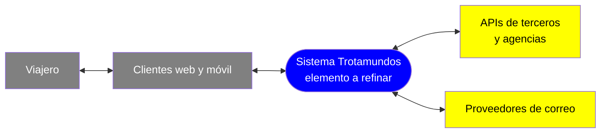
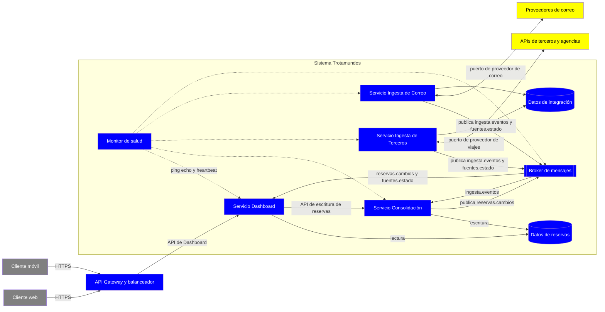
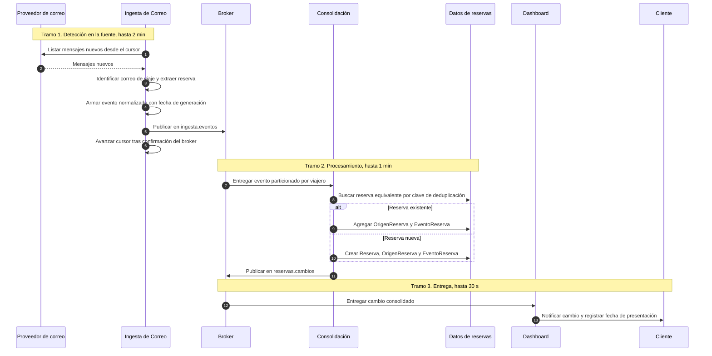
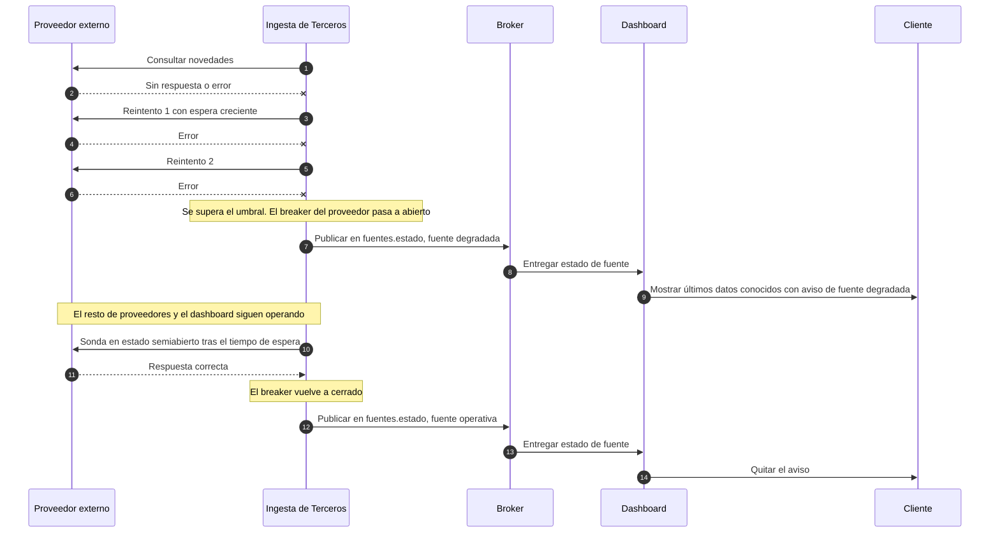
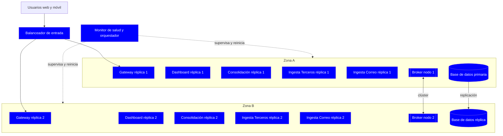

# Iteración 1 - Paso 3: Elegir los elementos del sistema a refinar

## Recordatorio de la meta (Paso 2)

**Meta de la iteración 1:** estructurar inicialmente el sistema, con su estilo general, su descomposición de alto nivel, el flujo de consolidación de reservas y la ingesta desacoplada de fuentes externas.

**Drivers seleccionados:** US01, QA01, QA04, QA14 y QA15. Los constraints C1 y C2 y el concern de neutralidad tecnológica aplican de forma transversal.

## Análisis del punto de partida

Trotamundos es un sistema **greenfield**. No hay iteraciones previas ni elementos heredados, y las únicas estructuras disponibles son las del diagrama de contexto y el modelo de dominio. Por eso el único elemento que se puede refinar es el sistema completo, que hoy es una caja negra con sus actores y sistemas externos.

## Elemento elegido

**Elemento a refinar: Sistema Trotamundos (sistema completo).** El enfoque será **top-down**: se descompone el sistema en elementos de nivel más fino que se instanciarán en el Paso 5.

## Relación del elemento con los drivers de la iteración

| Driver | Qué exige del refinamiento del sistema |
| --- | --- |
| **US01** | Un punto único de verdad para las reservas, que consolide fuentes manuales, de correo y de terceros sin duplicar. |
| **QA01** | Un camino de datos de baja latencia entre la fuente externa y el dashboard, con un tope de 5 minutos en el 95% de los casos. |
| **QA04** | Detección y recuperación de fallos con un máximo de 5 minutos de caída al mes. Un fallo de terceros solo avisa al usuario y no debe tirar el sistema. |
| **QA14** | Un punto de integración con APIs estándar que traduzca formatos heterogéneos al lenguaje del sistema. |
| **QA15** | Un punto de integración con proveedores de correo, neutral respecto del proveedor, que mantenga la sincronización. |

## Alcance de la refinación

- **Dentro del alcance:** la estructura lógica de alto nivel del backend, el desacoplamiento de la ingesta externa, la consolidación de reservas, la entrega al dashboard y la tolerancia a fallos básica.
- **Fuera de alcance (iteraciones posteriores):** la estrategia de datos a gran escala y el caché (iteración 2), la seguridad de acceso al correo y la extensibilidad por región y transporte (iteración 3), y el compartir, la analítica y las incidencias (iteración 4).

## Hipótesis a confirmar

1. Los clientes web y móvil se tratan por ahora como consumidores del backend y no se descomponen en esta iteración. Su detalle interno se pospone a la iteración 5.
2. La descomposición es lógica y no fija todavía el modelo de despliegue. Esa decisión se tomará con los conceptos de diseño del Paso 4.

# Iteración 1 - Paso 4: Elegir conceptos de diseño

## Meta de la iteración (recordatorio)

Estructurar el sistema greenfield y fijar la ingesta desacoplada de fuentes externas. Los drivers son **US01, QA01, QA04, QA14 y QA15**, con C1, C2 y la neutralidad tecnológica como transversales.

## Qué tensión resuelven los conceptos

Los drivers se contradicen en parte, y eso guía la elección.

| Tensión | Drivers | Consecuencia de diseño |
| --- | --- | --- |
| Las fuentes externas son lentas, heterogéneas y poco confiables, pero el dashboard debe mantenerse disponible. | QA04 con QA14 y QA15 | Hay que aislar la ingesta del camino de lectura del usuario. |
| Los datos deben llegar en menos de 5 minutos, pero las fuentes envían eventos en formatos distintos. | QA01 con QA14 y QA15 | Hay que normalizar rápido y en paralelo, sin acoplar el procesamiento a cada proveedor. |
| Se necesita tolerancia a fallos con un equipo de startup. | QA04 con las restricciones del proyecto | Se prefiere la mínima complejidad operativa que cumpla el objetivo. |

## 1. Estilos arquitectónicos (2 seleccionados)

| Concepto | Decisión | Alternativas descartadas | Justificación |
| --- | --- | --- | --- |
| **Publish-Subscribe (event-driven) con broker de mensajes** | **Seleccionado** | Request-response síncrono directo a cada fuente. Polling desde el backend de lectura. | Desacopla productores (ingesta externa) de consumidores (consolidación y dashboard). Esto protege QA04: un tercero caído no tumba el sistema, solo deja de producir eventos. Sirve a QA01 porque permite procesar en paralelo. Los eventos de alta, cambio y cancelación calzan con `EventoReserva` del dominio. **Trade-off:** hay consistencia eventual y el broker se vuelve un componente crítico que debe ser redundante. |
| **Service-based (servicios de grano grueso)** | **Seleccionado** | **Monolito modular:** más simple, pero un fallo o pico en la ingesta afecta a todo y no se puede escalar por separado. **Microservicios finos:** máximo aislamiento, pero con costo operativo alto para el tamaño del equipo y un prototipo. | Pocos servicios desplegables, cada uno con una razón clara para estar separado: ingesta, consolidación y lectura del dashboard. Permite aislar fallos y escalar la ingesta de forma independiente a la lectura. Adelanta QA06 y QA07 de la iteración 2 sin pagar el costo de los microservicios. **Trade-off:** más piezas que un monolito, con un despliegue más complejo. |

No se selecciona un tercer estilo. Layered, por ejemplo, se resuelve dentro de cada servicio y es una decisión de granularidad más fina.

## 2. Tácticas arquitectónicas

| Táctica | Atributo | Drivers | Alternativas descartadas | Justificación |
| --- | --- | --- | --- | --- |
| **Abstract common services + Use an intermediary:** un adaptador por proveedor que traduce al modelo canónico del sistema. | Integrabilidad | QA14, QA15 y el concern de neutralidad | Integración punto a punto dentro de la lógica de negocio. Conectores genéricos configurables sin adaptador propio. | Cada proveedor, sea API o correo, queda tras una interfaz común. Agregar uno nuevo no toca el núcleo. Reduce el tamaño y la distancia de las dependencias, y en el caso del correo evita depender de un proveedor específico. **Trade-off:** hay que mantener un adaptador por proveedor. |
| **Introduce concurrency** con consumidores paralelos sobre los eventos. | Performance | QA01 | Procesamiento secuencial. Escalar solo verticalmente. | Reduce el tiempo de bloqueo en la cola y ayuda a cumplir el tope de 5 minutos en el 95% de los casos. **Trade-off:** exige que el procesamiento sea idempotente y tolere eventos fuera de orden. |
| **Circuit breaker con reintentos acotados.** | Disponibilidad | QA04 y QA14 | Reintentos sin límite, que amplifican la falla. Fallar y propagar el error al usuario. | Aísla los fallos de terceros: cuando una fuente falla, el sistema deja de insistir, muestra el último dato conocido y avisa al usuario, como pide QA04. **Trade-off:** los timeouts mal calibrados generan falsos positivos. |
| **Detect and recover:** monitoreo con ping/echo y heartbeat, más réplicas redundantes de los servicios sin estado. | Disponibilidad | QA04 | Réplica fría, porque la recuperación es demasiado lenta para detectar en menos de 1 minuto. Intervención manual. | El monitor detecta en menos de 1 minuto. Las réplicas activas absorben el fallo sin pérdida de servicio. **Trade-off:** mayor costo de infraestructura y necesidad de un balanceador. |

## 3. Arquitectura de referencia

**No aplica en esta iteración.** Ninguna arquitectura de referencia estándar cubre el conjunto de drivers sin adaptaciones fuertes. Los estilos y tácticas elegidos resuelven la meta con más precisión.

## 4. Componentes externos preexistentes

Para respetar la neutralidad tecnológica, se eligen **categorías genéricas** y no productos. La selección concreta de producto queda para un MADR posterior.

| Categoría | Decisión | Alternativa descartada | Justificación |
| --- | --- | --- | --- |
| **Broker de mensajes** con interfaz genérica y alta disponibilidad | Seleccionado | Cola implementada en la propia base de datos | Soporta publish-subscribe, reintentos y colas acotadas. La cola en base de datos mezcla cargas y no escala igual. |
| **Plataforma de contenedores con orquestación** | Seleccionado | Máquinas virtuales gestionadas a mano | Habilita réplicas, reinicio automático y balanceo, que requieren las tácticas de disponibilidad. |
| **Base de datos relacional gestionada con réplica** | Seleccionado | Base documental como almacén principal | El modelo de dominio está muy relacionado, con Viaje, Reserva, OrigenReserva y EventoReserva. La estrategia de datos a gran escala se refina en la iteración 2. |

## Trazabilidad con los drivers

| Driver | Estilos | Tácticas | Componentes |
| --- | --- | --- | --- |
| US01 | Service-based | Abstract common services | Base relacional |
| QA01 | Publish-Subscribe | Introduce concurrency | Broker |
| QA04 | Publish-Subscribe y Service-based | Circuit breaker, detect and recover | Orquestador y broker con alta disponibilidad |
| QA14 | Publish-Subscribe | Abstract common services y circuit breaker | Broker |
| QA15 | Publish-Subscribe | Abstract common services | Broker |

## Riesgos y supuestos a confirmar

1. **Latencia de QA01 y correo.** US02 pide sondear la bandeja. Con 5 minutos de tope total, el intervalo de escaneo debe ser de pocos minutos. Si el proveedor ofrece notificaciones push, se usarían, y si no, se sondea.
2. **Consistencia eventual.** El dashboard puede mostrar datos con unos segundos de retraso. Asumo que es aceptable para el negocio.
3. **El broker es un punto crítico.** Debe desplegarse con redundancia, porque de otro modo anula la ganancia de QA04.
4. **Granularidad de servicios.** La separación exacta en servicios se define en el Paso 5, no aquí.

---

# Iteración 1 - Paso 5: Instanciar elementos, asignar responsabilidades y definir interfaces

## 1. Instanciación de los conceptos de diseño

El Paso 4 eligió conceptos genéricos. Aquí cada uno se convierte en elementos concretos del sistema.

| Concepto (Paso 4) | Instanciación |
| --- | --- |
| Service-based | 4 servicios de negocio: **Ingesta de Terceros**, **Ingesta de Correo**, **Consolidación** y **Dashboard**. |
| Publish-Subscribe con broker | 1 broker con 4 canales lógicos (sección 4). |
| Abstract common services / Intermediary | Un **puerto de proveedor** por tipo de fuente, con un adaptador por proveedor dentro de cada servicio de ingesta. Todos producen el mismo **evento normalizado**. |
| Introduce concurrency | Consolidación con **N consumidores competidores**, con partición por viajero para preservar el orden de los eventos de una misma reserva. |
| Circuit breaker con reintentos acotados | Un breaker **por proveedor** dentro de cada adaptador. Al abrirse, emite un evento de estado de la fuente. |
| Detect and recover | **Monitor de salud** externo a los servicios, **réplicas** mínimas por servicio sin estado y alta disponibilidad en broker y base de datos. |
| Contenedores con orquestación, base relacional, broker | Infraestructura de ejecución. No tiene lógica de negocio. |

**Por qué 4 servicios y no más.** Cada uno existe por una razón de aislamiento o escalado distinta:

| Servicio | Razón de ser separado |
| --- | --- |
| Ingesta de Terceros | Su carga depende de la cantidad de proveedores y de sus caídas. |
| Ingesta de Correo | Su carga depende del volumen de cuentas conectadas. Usa un patrón de acceso distinto, con parseo de texto no estructurado y sondeo. |
| Consolidación | Es el único escritor de reservas, y concentra la deduplicación en un solo lugar. |
| Dashboard | Debe escalar con el tráfico de lectura y no depender de la salud de la ingesta. |

Separar la ingesta de Terceros y la de Correo evita que un problema de parseo de correos afecte las integraciones con APIs.

## 2. Elementos y responsabilidades

| Elemento | Responsabilidades | Entidades del dominio | Propiedades |
| --- | --- | --- | --- |
| **API Gateway y balanceador** | Punto de entrada único para web y móvil (C1). Enruta, termina TLS y balancea entre réplicas del Dashboard y de Consolidación. | N/A | Sin estado, 2 o más réplicas. |
| **Servicio Dashboard** | Consulta de viajes y reservas organizados por viaje. Mantiene el estado visible de cada fuente. Empuja a los clientes los cambios recibidos del broker. Recibe las altas, cambios y bajas manuales y las delega a Consolidación. | Viajero, Viaje, Reserva, CuentaCorreo y estado de fuentes, en modo lectura | Sin estado, 2 o más réplicas, solo lectura sobre los datos de reservas. |
| **Servicio Consolidación** | **Único escritor de reservas.** Consume eventos normalizados. Deduplica y fusiona fuentes en una sola `Reserva`. Asocia la reserva a un `Viaje`. Registra `OrigenReserva` y `EventoReserva` con las dos fechas necesarias para medir QA01. Aplica las operaciones manuales. Publica los cambios consolidados. | Reserva y especializaciones, OrigenReserva, EventoReserva, Viaje | Sin estado, 2 o más réplicas, consumidores competidores. |
| **Servicio Ingesta de Terceros** | Se conecta a sistemas de viajes y agencias vía APIs estándar mediante adaptadores. Recibe notificaciones cuando el proveedor las ofrece, y si no hace sondeo con un intervalo acotado. Traduce al evento normalizado. Controla el circuit breaker por proveedor. Publica el estado de cada fuente. | ProveedorViajes, AgenciaViajes | Estado mínimo de cursores de sondeo, 2 o más réplicas. |
| **Servicio Ingesta de Correo** | Mantiene la conexión con la cuenta de correo mediante adaptadores por proveedor. Sondea los mensajes nuevos, identifica los relacionados con viajes y extrae los datos de reserva y el remitente. Traduce al evento normalizado. Controla el circuit breaker por proveedor. | CuentaCorreo | Estado de cursor de escaneo por cuenta, 2 o más réplicas, con reparto de cuentas entre réplicas. |
| **Broker de mensajes** | Transporta los eventos entre servicios con entrega garantizada y colas acotadas. Soporta reintentos y una cola de mensajes inválidos. | N/A | Clúster con alta disponibilidad. |
| **Datos de reservas** | Almacén relacional de Viaje, Reserva, OrigenReserva y EventoReserva. | Las anteriores | Réplica con failover. Escritura solo desde Consolidación. |
| **Datos de integración** | Almacén separado de configuración y estado de conexiones, es decir CuentaCorreo, ProveedorViajes y cursores. | CuentaCorreo, ProveedorViajes | Mismo motor, esquema separado. Escritura solo desde las ingestas. |
| **Monitor de salud** | Aplica ping/echo y heartbeat a servicios, broker y bases de datos. Alerta ante fallos y dispara la recuperación vía orquestador. | N/A | Independiente de los servicios monitoreados. |

### Decisiones de asignación de responsabilidades

- **Consolidación es el único escritor.** Concentra la deduplicación de US01 en un punto y evita condiciones de carrera entre fuentes.
  - El Dashboard le delega las operaciones manuales por interfaz sincrónica. Así la lectura del usuario nunca depende de Consolidación, y solo la escritura lo hace.
  - **Trade-off:** acopla las escrituras manuales a la disponibilidad de Consolidación, mitigado con réplicas.
- **Propiedad de datos por servicio.** Hay dos esquemas separados, uno de reservas y otro de integración. Ningún servicio escribe en datos ajenos, lo que mantiene bajo el acoplamiento.
- **La ingesta no consolida.** Los adaptadores traducen formato, pero no deciden si algo es un duplicado. Cambiar la regla de deduplicación no toca los adaptadores.
- **Los fallos de terceros no tocan al Dashboard.** Un breaker abierto produce un evento de estado. El Dashboard muestra los últimos datos y un aviso, como pide QA04.

## 3. Instanciación de las tácticas con parámetros

| Táctica | Parámetros definidos | Driver |
| --- | --- | --- |
| Concurrency | Partición por identificador de viajero. Consumidores idempotentes mediante la clave de evento de origen. | QA01 |
| Circuit breaker | Un breaker por proveedor, con estados abierto, semiabierto y cerrado. Reintentos acotados con espera creciente. Los umbrales se calibran en el prototipo. | QA04, QA14 |
| Monitor y réplicas | Heartbeat cada 10 s, con fallo declarado tras 3 omisiones, es decir unos 30 s. Cumple la detección menor a 1 minuto. | QA04 |
| Cola de mensajes inválidos | Los eventos que no se pueden parsear ni procesar van a una cola aparte, y no bloquean el flujo. | QA14 |

### Presupuesto de latencia para QA01

QA01 mide desde la generación en la fuente. El intervalo de sondeo cuenta dentro del límite de 5 minutos.

| Tramo | Presupuesto p95 |
| --- | --- |
| Detección en la fuente: sondeo de terceros y de correo | 2 min como máximo |
| Adaptador, broker y Consolidación | 1 min |
| Entrega al dashboard | 30 s |
| **Total** | **3,5 min, con 1,5 min de margen** |

## 4. Interfaces

### 4.1.- Canales del broker

| Canal | Productor | Consumidor | Contenido |
| --- | --- | --- | --- |
| `ingesta.eventos` | Ingesta de Terceros, Ingesta de Correo | Consolidación | Evento normalizado de reserva. |
| `reservas.cambios` | Consolidación | Dashboard, y más adelante analítica y recomendación | Cambio ya consolidado de una reserva. |
| `fuentes.estado` | Ingesta de Terceros, Ingesta de Correo | Dashboard | Fuente operativa, degradada o con reconexión requerida. |
| `ingesta.invalidos` | Cualquier consumidor | Operación | Eventos descartados, con su motivo. |

### 4.2.- Interfaces sincrónicas

| Interfaz | Proveedor | Consumidor | Operaciones | Driver |
| --- | --- | --- | --- | --- |
| **API de Dashboard** | Dashboard, vía Gateway | Web y móvil | Consultar viajes con sus reservas. Consultar el estado de las fuentes. Suscribirse a cambios. Alta, edición y baja manual de reservas. | US01 |
| **API de Escritura de Reservas** | Consolidación | Dashboard | Registrar, modificar y eliminar una reserva manual. Devuelve el resultado consolidado. | US01 |
| **Puerto de Proveedor de Viajes** | Adaptador de proveedor | Ingesta de Terceros, núcleo | Consultar novedades desde un cursor. Recibir una notificación del proveedor. Informar su estado. | QA14 |
| **Puerto de Proveedor de Correo** | Adaptador de correo | Ingesta de Correo, núcleo | Autorizar la conexión. Listar mensajes nuevos desde un cursor. Obtener un mensaje. Informar su estado. | QA15 |
| **Chequeo de salud** | Todo servicio | Monitor | Operación de vivo y de listo, más heartbeat saliente. | QA04 |

Los dos puertos son contratos neutrales respecto de cualquier proveedor concreto. Eso cumple el concern de tecnologías genéricas y es lo que habilita agregar proveedores sin tocar el núcleo, que se refinará en la iteración 3 con QA10 y QA13.

### 4.3.- Contrato del evento normalizado

Es el contrato más importante de la iteración. Define el lenguaje común entre ingesta y consolidación.

| Campo | Descripción | Uso |
| --- | --- | --- |
| Identificador de evento de origen | Clave estable que identifica el evento en la fuente. | Idempotencia y deduplicación. |
| Tipo de evento | Alta, modificación o cancelación. | `EventoReserva`. |
| Viajero | Dueño de la reserva. | Partición y autorización. |
| Origen | Tipo, referencia externa y proveedor. Remitente si es correo. | `OrigenReserva`, y US03 más adelante. |
| Fecha de generación en la fuente | Momento en que la fuente generó el evento. | Medición de QA01. |
| Fecha de recepción | Momento en que ingresó al sistema. | Medición de QA01. |
| Datos de la reserva | Tipo, medio, fechas, destino, código de confirmación y datos específicos. | `Reserva` y especializaciones. |

### 4.4.- Contrato del evento de estado de fuente

| Campo | Descripción |
| --- | --- |
| Fuente | Proveedor o cuenta afectada. |
| Estado | Operativa, degradada o con reconexión requerida. |
| Desde cuándo | Momento del cambio de estado. |

## 5. Justificación

- **Instanciación.** Cada servicio responde a un driver concreto: aislamiento de fallos para QA04, adaptación de fuentes para QA14 y QA15, un camino rápido y concurrente para QA01 y un único punto de verdad para US01.
- **Asignación de responsabilidades.** La alta cohesión se logra con un solo dueño por tipo de dato. El bajo acoplamiento se logra porque todo cruce entre servicios pasa por un contrato, sea evento o puerto.
- **Interfaces.** Los contratos están definidos por operaciones y campos, no por tecnología, como pide C2 y el concern de neutralidad. La definición formal, por ejemplo OpenAPI o AsyncAPI, queda para la sección 6 de `Architecture.md`.

## 6. Supuestos y puntos abiertos

1. **Clave de deduplicación.** Propongo usar viajero, proveedor y código de confirmación, con una heurística de fechas y destino cuando falte el código. Es el punto de mayor riesgo funcional y habría que validarlo con datos reales de correos.
2. **Asociación de reservas a viajes.** Asumo que se asigna por solapamiento de fechas y destino, o se crea un viaje nuevo. Hay que confirmarlo con el negocio.
3. **Entrega al cliente.** Dejo definida la suscripción a cambios sin fijar el mecanismo concreto, que se decide en el Paso 6.
4. **Fuera de esta iteración.** Las reglas de filtros y whitelist, el cifrado y la autorización del acceso al correo, la estrategia de datos a gran escala y el caché quedan para las iteraciones 2 y 3. El diseño actual deja los puntos de enganche: el campo de remitente en el evento y los esquemas separados.

---

# Iteración 1 - Paso 6: Bocetar vistas y registrar decisiones de diseño

## 1. Selección de vistas

Cada vista responde a una pregunta que los drivers de la iteración exigen contestar.

| Vista | Tipo | Por qué se elige | Drivers |
| --- | --- | --- | --- |
| **V1. Componentes y conectores** | C&C | Muestra los servicios, el broker, los datos y quién habla con quién. Es la vista principal para razonar sobre latencia y aislamiento de fallos. | US01, QA01, QA04, QA14, QA15 |
| **V2. Secuencia: de un correo al dashboard** | Comportamiento | Permite verificar el presupuesto de 5 minutos de QA01 tramo por tramo, y ver la idempotencia y la deduplicación. | US01, QA01, QA15 |
| **V3. Secuencia: falla de un tercero** | Comportamiento | Es la forma más directa de comprobar que el fallo de un proveedor no tira el sistema, como exige QA04. | QA04, QA14 |
| **V4. Despliegue** | Allocation | La disponibilidad se decide en la asignación a nodos y zonas, no solo en la lógica. | QA04 |

No se incluye una vista de módulos. Los servicios ya son las unidades de módulo en esta etapa, y su descomposición interna pertenece a iteraciones posteriores.

## 2. V1 - Componentes y conectores

**Convenciones.** Azul indica elementos propios, amarillo sistemas externos y gris clientes. Las líneas punteadas indican monitoreo.

**Puntos clave de lectura:**

- **El camino de lectura no pasa por la ingesta.** Dashboard lee de Datos de reservas y recibe cambios del broker. Si la ingesta cae, el dashboard sigue funcionando.
- **Un solo camino de escritura.** Todo cambio de reservas pasa por Consolidación, ya venga de una ingesta o de una acción manual.
- **Los puertos son la frontera con lo externo.** Ahí viven los adaptadores y los circuit breakers.

### Catálogo de elementos

| Elemento | Responsabilidad principal | Interfaces provistas | Interfaces requeridas |
| --- | --- | --- | --- |
| API Gateway y balanceador | Entrada única y balanceo | HTTPS para clientes | API de Dashboard |
| Servicio Dashboard | Consulta y notificación de cambios | API de Dashboard, chequeo de salud | Datos de reservas, API de escritura, canales `reservas.cambios` y `fuentes.estado` |
| Servicio Consolidación | Único escritor, deduplicación y fusión | API de escritura de reservas, chequeo de salud | Canal `ingesta.eventos`, Datos de reservas, canal `reservas.cambios` |
| Servicio Ingesta de Terceros | Adaptar APIs de proveedores y agencias | Chequeo de salud | Puerto de proveedor de viajes, Datos de integración, canales `ingesta.eventos` y `fuentes.estado` |
| Servicio Ingesta de Correo | Adaptar cuentas de correo | Chequeo de salud | Puerto de proveedor de correo, Datos de integración, canales `ingesta.eventos` y `fuentes.estado` |
| Broker de mensajes | Transporte de eventos | Los 4 canales | N/A |
| Monitor de salud | Detección de fallos | N/A | Chequeo de salud de todos |

## 3. V2 - Secuencia: de un correo al dashboard

**Qué se verifica con esta vista:**

- El **cursor avanza solo después de la confirmación del broker**. Si el servicio falla a mitad de camino, reprocesa y no pierde mensajes. Por eso Consolidación debe ser idempotente.
- La **deduplicación es un paso explícito** dentro de Consolidación, no de la ingesta.
- Las **dos marcas de tiempo**, generación en fuente y presentación, permiten medir QA01 de punta a punta, tal como lo prevé `EventoReserva`.

## 4. V3 - Secuencia: falla de un tercero

**Qué se verifica con esta vista:**

- El fallo queda **contenido en el breaker de ese proveedor**. Los otros proveedores, la consolidación y el dashboard no se enteran más que por el evento de estado.
- El usuario recibe **el aviso exigido por QA04** y no un error.
- La recuperación es **automática** mediante la sonda semiabierta.

## 5. V4 - Despliegue

**Decisiones visibles en esta vista:**

- **Dos zonas con réplicas activas** de cada servicio. La pérdida de una zona no interrumpe el servicio.
- **Broker en clúster y base con réplica**, para que no sean puntos únicos de falla.
- **Monitor fuera de los servicios que supervisa**, y con capacidad de reinicio automático.
- **Supuesto:** hay 2 zonas de disponibilidad. Esto se confirmará con la elección de infraestructura.

## 6. Registro de decisiones MADR

Estas decisiones se registran con estado **Propuesta** hasta que las confirmes. Se ubicarán en la sección 7 de `Architecture.md`, y las vistas anteriores en la sección 5.

### ADR-001: Estilo publish-subscribe con broker de mensajes para la ingesta

- **Estado:** Propuesta
- **Contexto y problema:** Las fuentes externas son lentas y poco confiables, y el dashboard debe mantenerse disponible y actualizado en menos de 5 minutos. ¿Cómo comunicamos ingesta, consolidación y dashboard?
- **Drivers de decisión:** QA01, QA04, QA14, QA15 y el concern de neutralidad tecnológica.
- **Opciones consideradas:**
  1. Publish-subscribe con broker.
  2. Request-response síncrono entre servicios.
  3. Sondeo periódico del backend de lectura sobre las fuentes.
- **Resultado de la decisión:** Opción 1, porque desacopla los productores de los consumidores y aísla fallos.
- **Consecuencias:**
  - Positivas: la caída de un tercero no tumba el sistema, se procesa en paralelo, y el historial de `EventoReserva` encaja con el modelo de dominio.
  - Negativas: hay consistencia eventual y el broker pasa a ser un componente crítico que debe ser redundante.
- **Pros y contras de las alternativas:**
  - Opción 2: es más simple, pero acopla la disponibilidad de cada servicio a la del siguiente y propaga la lentitud.
  - Opción 3: es simple, pero el dashboard queda atado a la latencia de las fuentes y no escala.

### ADR-002: Arquitectura service-based con 4 servicios de grano grueso

- **Estado:** Propuesta
- **Contexto y problema:** Se necesita aislar fallos y escalar por separado la ingesta y la lectura, con un equipo y prototipo acotados.
- **Drivers de decisión:** QA04, QA01 y las restricciones de tamaño de equipo.
- **Opciones consideradas:**
  1. Service-based con 4 servicios.
  2. Monolito modular.
  3. Microservicios de grano fino.
- **Resultado de la decisión:** Opción 1, con los servicios Dashboard, Consolidación, Ingesta de Terceros e Ingesta de Correo.
- **Consecuencias:**
  - Positivas: aislamiento donde importa y escalado independiente de la ingesta y la lectura.
  - Negativas: más piezas y un despliegue más complejo que un monolito.
- **Pros y contras de las alternativas:**
  - Opción 2: es la más simple de operar, pero un pico o error de parseo en la ingesta afecta a todo.
  - Opción 3: máximo aislamiento, pero con un costo operativo desproporcionado para el prototipo.

### ADR-003: Puertos de proveedor con adaptadores y modelo canónico

- **Estado:** Propuesta
- **Contexto y problema:** Los proveedores de viajes y de correo tienen formatos y protocolos distintos, y no queremos depender de ninguno.
- **Drivers de decisión:** QA14, QA15 y el concern de neutralidad. Prepara también QA10 y QA13.
- **Opciones consideradas:**
  1. Un puerto por tipo de fuente, con un adaptador por proveedor y un evento normalizado.
  2. Integración directa en la lógica de negocio.
  3. Conectores genéricos configurables, sin adaptador propio.
- **Resultado de la decisión:** Opción 1.
- **Consecuencias:**
  - Positivas: agregar un proveedor no toca el núcleo, y el contrato del evento fija el lenguaje común.
  - Negativas: hay que mantener un adaptador por proveedor, y el modelo canónico puede quedarse corto para casos raros.
- **Pros y contras de las alternativas:**
  - Opción 2: rápida al inicio, pero acopla el núcleo a cada proveedor.
  - Opción 3: reduce código, pero los formatos reales rara vez se cubren solo con configuración.

### ADR-004: Consolidación como único escritor de reservas, con consumidores idempotentes

- **Estado:** Propuesta
- **Contexto y problema:** US01 exige un único punto de verdad que no duplique reservas de fuentes distintas, y QA01 pide procesar en paralelo.
- **Drivers de decisión:** US01, QA01.
- **Opciones consideradas:**
  1. Un único servicio escritor, con consumidores competidores particionados por viajero e idempotentes.
  2. Cada ingesta escribe directamente en la base de reservas.
  3. Un único consumidor secuencial.
- **Resultado de la decisión:** Opción 1.
- **Consecuencias:**
  - Positivas: la deduplicación está en un solo lugar, el orden por reserva se preserva con la partición, y el reproceso es seguro.
  - Negativas: las escrituras manuales dependen de la disponibilidad de Consolidación, mitigada con réplicas. La clave de deduplicación es un riesgo funcional abierto.
- **Pros y contras de las alternativas:**
  - Opción 2: elimina un salto, pero produce condiciones de carrera y lógica de deduplicación repetida.
  - Opción 3: es la más simple, pero limita el rendimiento y no escala para la iteración 2.

### ADR-005: Circuit breaker por proveedor con reintentos acotados

- **Estado:** Propuesta
- **Contexto y problema:** Un proveedor caído no debe degradar al sistema ni a los otros proveedores, y el usuario debe ser avisado.
- **Drivers de decisión:** QA04, QA14.
- **Opciones consideradas:**
  1. Breaker por proveedor con reintentos acotados y evento de estado de fuente.
  2. Reintentos sin límite.
  3. Fallar y propagar el error al usuario.
- **Resultado de la decisión:** Opción 1.
- **Consecuencias:**
  - Positivas: el fallo queda contenido, la recuperación es automática y el dashboard muestra datos con aviso.
  - Negativas: los umbrales y timeouts requieren calibración, y un valor mal elegido causa falsos positivos.
- **Pros y contras de las alternativas:**
  - Opción 2: puede amplificar la falla y cargar a un proveedor ya degradado.
  - Opción 3: viola QA04, que pide solo avisar al usuario.

### ADR-006: Monitor de salud y réplicas activas en dos zonas

- **Estado:** Propuesta
- **Contexto y problema:** Se permite un máximo de 5 minutos de caída al mes, y la detección debe ser menor a 1 minuto.
- **Drivers de decisión:** QA04.
- **Opciones consideradas:**
  1. Monitor externo con ping/echo y heartbeat, más réplicas activas en dos zonas.
  2. Réplicas frías que se encienden al fallar.
  3. Recuperación manual con alertas.
- **Resultado de la decisión:** Opción 1, con heartbeat cada 10 s y fallo declarado tras 3 omisiones.
- **Consecuencias:**
  - Positivas: detección en unos 30 s y conmutación sin interrupción visible.
  - Negativas: mayor costo de infraestructura. Un fallo simultáneo en ambas zonas queda fuera de cobertura.
- **Pros y contras de las alternativas:**
  - Opción 2: es más barata, pero la recuperación es demasiado lenta para el presupuesto de QA04.
  - Opción 3: no puede cumplir la detección menor a 1 minuto de forma confiable.

### ADR-007: Infraestructura por categorías genéricas

- **Estado:** Propuesta
- **Contexto y problema:** Se necesita infraestructura de ejecución, mensajería y datos sin atar el diseño a un producto específico.
- **Drivers de decisión:** Concern de neutralidad tecnológica, C2 y QA04.
- **Opciones consideradas:**
  1. Fijar solo las categorías: broker de mensajes, plataforma de contenedores con orquestación y base relacional gestionada con réplica.
  2. Fijar productos concretos desde ahora.
- **Resultado de la decisión:** Opción 1. La elección del producto se registrará en un MADR posterior, cuando se evalúe costo y soporte.
- **Consecuencias:**
  - Positivas: mantiene abiertas las opciones y respeta el concern.
  - Negativas: quedan decisiones de producto pendientes antes de construir el prototipo.
- **Pros y contras de las alternativas:**
  - Opción 2: acelera el arranque, pero crea dependencias tempranas sin evidencia.

## 7. Trazabilidad entre decisiones y drivers

| Decisión | US01 | QA01 | QA04 | QA14 | QA15 |
| --- | --- | --- | --- | --- | --- |
| ADR-001 Publish-subscribe | | X | X | X | X |
| ADR-002 Service-based | X | X | X | | |
| ADR-003 Puertos y adaptadores | X | | | X | X |
| ADR-004 Único escritor | X | X | | | |
| ADR-005 Circuit breaker | | | X | X | |
| ADR-006 Monitor y réplicas | | | X | | |
| ADR-007 Infraestructura genérica | | | X | | |

## 8. Supuestos y puntos abiertos

1. **Zonas de disponibilidad.** Los diagramas asumen 2 zonas. Si el entorno solo ofrece una, QA04 queda en riesgo.
2. **Mecanismo de entrega al cliente.** V2 indica "notificar cambio" sin fijar el medio, porque depende de la tecnología de los clientes.
3. **Valores de umbrales.** Los intervalos de heartbeat, reintentos y breakers son punto de partida, y se calibrarán con el prototipo.

---

# Iteración 1 - Paso 7: Análisis del diseño y revisión de la meta

## 1. Análisis por driver

Cada driver se evalúa contra las decisiones tomadas. Uso tres estados: **Completo** (el diseño lo satisface en esta etapa), **Parcial** (la estructura está, pero queda trabajo o un riesgo abierto) y **No abordado**.

| Driver | Estado | Cómo lo satisface el diseño | Lo que queda abierto |
| --- | --- | --- | --- |
| **US01 Dashboard** | **Parcial** | Único escritor (ADR-004), reserva consolidada con múltiples orígenes, API de lectura y de escritura manual, camino de lectura aislado de la ingesta. | Los clientes web y móvil no están descompuestos, solo existen como consumidores del Gateway. La regla exacta de deduplicación está sin validar. |
| **QA01 Presentar updates** | **Parcial** | Presupuesto de 3,5 min con 1,5 min de margen sobre el tope de 5. Concurrencia, idempotencia y las marcas de tiempo para medir el cumplimiento. | El tramo de sondeo de correo no escala como está planteado (ver riesgo R1). |
| **QA04 Inactividad no planificada** | **Parcial** | Réplicas en dos zonas, monitor con detección en unos 30 s, breaker por proveedor, broker y base con alta disponibilidad. | Quedan puntos únicos de falla y el presupuesto de caída no está calculado (ver R2 y R3). |
| **QA14 APIs estándar** | **Completo para la iteración** | Puerto de proveedor, adaptadores y evento normalizado. El breaker acota los fallos de terceros. La cola de inválidos aísla lo no parseable. | La medición de status 2xx en el 90% requiere instrumentación, que se define al construir. |
| **QA15 Proveedores de correo** | **Parcial** | Puerto de correo neutral respecto del proveedor, con cursor y estado de fuente. | La autenticación y autorización de la cuenta, y la conexión permanente, dependen de la seguridad de la iteración 3 (QA08). |

**Avance de la ronda.** La iteración abordó 5 de los 24 drivers, 1 de 8 historias y 4 de 16 escenarios. Son los de mayor riesgo, así que el avance en riesgo es mayor que el porcentaje de cantidad.

## 2. Análisis de tácticas de disponibilidad

Siguiendo el cuestionario por tácticas de Bass, estas son las tácticas de disponibilidad frente al diseño actual.

| Táctica | ¿Soportada? | Dónde | Riesgo |
| --- | --- | --- | --- |
| Ping/echo y heartbeat | Sí | Monitor de salud, ADR-006 | Bajo |
| Redundant spare, activa | Sí | Réplicas en dos zonas | Medio, ver R3 |
| Circuit breaker y reintentos acotados | Sí | Adaptadores, ADR-005 | Bajo, requiere calibrar |
| Graceful degradation | Sí | Dashboard muestra últimos datos con aviso | Bajo |
| Retry | Sí | Reproceso del cursor tras fallo | Bajo, depende de idempotencia |
| Shadow y state resynchronization al reintroducir | **Parcial** | No se definió cómo se reincorpora una réplica | Medio |
| Rollback o transacciones | **No** | No se definió consistencia entre la escritura en base y la publicación en el broker | **Alto**, ver R4 |
| Monitor redundante | **No** | El monitor es único | Medio, ver R2 |

## 3. Riesgos, puntos de sensibilidad y trade-offs

### Riesgos que cambian el plan

| ID | Riesgo | Impacto | Gravedad |
| --- | --- | --- | --- |
| **R1** | **El sondeo de correo no escala.** Con 2 M de usuarios activos y un sondeo cada 2 minutos, serían unas 16.700 consultas por segundo hacia los proveedores de correo, solo para detectar mensajes. A esa tasa los proveedores aplican límites de uso. | Compromete QA01 y la operación a escala. Hoy el presupuesto de 2 min de detección lo ignora. | **Alta** |
| **R2** | **El monitor de salud es un punto único de falla.** Si cae, la detección en menos de 1 minuto deja de cumplirse. | QA04 | Media |
| **R3** | **El presupuesto de QA04 es muy ajustado.** 5 minutos al mes equivalen a una disponibilidad de unos 99,988%. Un solo failover de base de datos de 2 minutos consume el 40% del mes. El diseño no cuantifica el tiempo de failover de la base, del broker ni del Gateway. | QA04 | **Alta** |
| **R4** | **Consistencia entre base y broker.** Consolidación escribe en la base y luego publica el cambio. Si falla entre ambos pasos, el dashboard no se entera del cambio o se publica algo que no se guardó. | US01, QA01 | **Alta** |
| **R5** | **Clave de deduplicación sin validar.** Una mala heurística genera duplicados o fusiones erróneas, y ambos errores son visibles para el usuario. | US01 | Media |

### Puntos de sensibilidad

- **Intervalo de sondeo y partición del broker.** Pequeños cambios en estos valores mueven directamente la latencia de QA01.
- **Umbrales de los breakers.** Un valor demasiado bajo genera falsos positivos y baja la disponibilidad percibida. Uno demasiado alto retrasa el aviso al usuario.

### Trade-offs asumidos

| Decisión | Se gana | Se paga |
| --- | --- | --- |
| Publish-subscribe | Aislamiento y paralelismo | Consistencia eventual y broker crítico |
| Único escritor | Deduplicación en un solo lugar | Las escrituras manuales dependen de Consolidación |
| Service-based | Menor costo operativo que microservicios | Menos aislamiento fino que microservicios |
| Réplicas activas en dos zonas | Conmutación sin interrupción | Mayor costo de infraestructura |

## 4. Respuestas a las preguntas del paso

**¿Cuánto diseño llevamos hecho?** Tenemos la estructura de alto nivel y los contratos principales. Falta la estrategia de datos a gran escala, la seguridad, la extensibilidad y las funcionalidades secundarias.

**¿Se cumplió la meta?** **Sí, en lo estructural.** La meta era estructurar el sistema, fijar su estilo, su descomposición, el flujo de consolidación y la ingesta desacoplada. Todo eso está definido, visualizado y registrado. Ningún driver quedó sin abordar, pero **4 de 5 quedaron parciales** por razones concretas que figuran arriba. Eso es esperable en una primera iteración, y ninguno de los vacíos invalida la estructura elegida.

**¿Hace falta otra iteración?** **Sí, pero no repetir la 1.** Propongo cerrar la iteración 1 y pasar a la 2 con ajustes al plan, en lugar de agregar una iteración 1b. Los riesgos encontrados caben en las iteraciones previstas.

## 5. Ajustes propuestos al plan de iteraciones

| Riesgo | Dónde se resuelve | Cambio al `IterationPlan.md` |
| --- | --- | --- |
| R1 Sondeo de correo a escala | **Iteración 2** | Agregar al alcance: estrategia de detección que escale, con notificaciones push donde el proveedor las ofrezca y frecuencia de sondeo adaptativa según actividad. Se vincula con QA06 y QA07. |
| R3 Presupuesto de QA04 | **Iteración 2** | Agregar el cálculo del presupuesto de caída y los tiempos de failover de base, broker y Gateway. Justifica las decisiones de datos y de balanceo. |
| R4 Consistencia base y broker | **Iteración 2** | Agregar al alcance de datos un mecanismo que haga atómicas la escritura y la publicación. Es parte de la estrategia de datos. |
| R2 Monitor único | **Iteración 2** | Agregar redundancia del monitor. Es un cambio menor. |
| R5 Deduplicación | **Iteración 3** | Ya está en su alcance, con US04. Validar la clave con datos reales de correos. |
| QA15, autenticación del correo | **Iteración 3** | Sin cambio. Ya está en su alcance, con QA08. |
| Descomposición de clientes | **Iteración 5** | Sin cambio. |

## 6. Estado del tablero de diseño

| Not Yet Addressed | Partially Addressed | Completely Addressed |
| --- | --- | --- |
| US02, US03, US04, US05, US06, US07, US08 | **US01, QA01, QA04, QA15** | **QA14** |
| QA02, QA03, QA05, QA06, QA07, QA08, QA09, QA10, QA11, QA12, QA13, QA16 | | |

## 7. Producto de la iteración

| Entregable | Ubicación prevista |
| --- | --- |
| Contexto, drivers y modelo de dominio | Secciones 2, 3 y 4 de `Architecture.md` |
| 4 vistas: componentes, dos secuencias y despliegue | Sección 5 |
| Contratos de canales, APIs, puertos y eventos | Sección 6 |
| ADR-001 a ADR-007, con trazabilidad | Sección 7 |
| Riesgos abiertos R1 a R5 | Se agregan como entrada del Paso 1 de la iteración 2 |

---

**Conclusión:** la meta de la iteración 1 se cumplió y la estructura base es sólida. Los riesgos más importantes, sobre todo R1, R3 y R4, no invalidan el diseño, pero conviene absorberlos en la iteración 2.