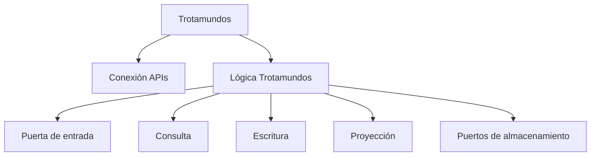
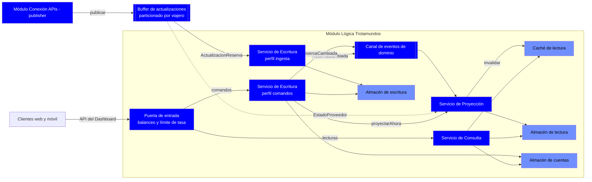
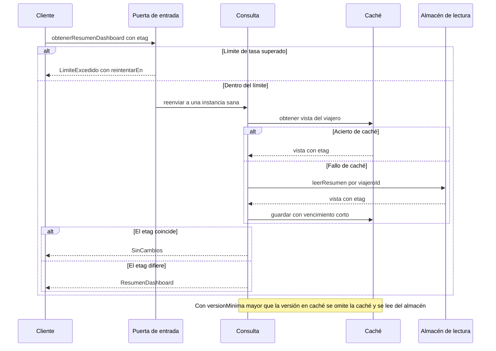
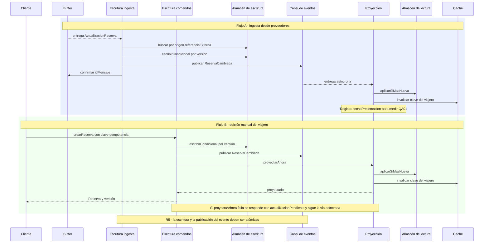
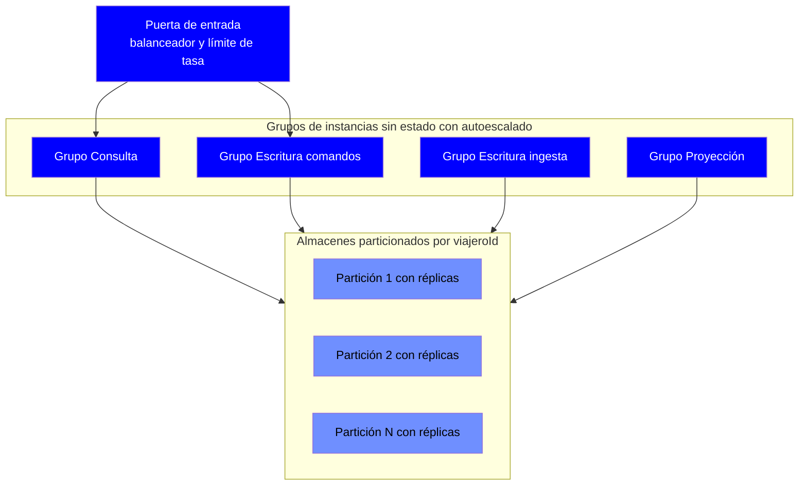

# Iteración 2 - Paso 3: Elegir los elementos del sistema a refinar

## Recordatorio de la meta (Paso 2, según IterationPlan.md)

**Meta de la iteración 2:** Escalabilidad y rendimiento del núcleo. Soportar 15 M de cuentas, 2 M de usuarios semanales, 500 req/s y picos de 2500 req/s, con tiempos de respuesta de web y de primer contenido móvil.

**Drivers:** QA05, QA06, QA07, QA02, QA03.

## Estado de los elementos tras la iteración 1

Es un sistema con decisiones previas, por lo que los candidatos son los resultados de la iteración 1 y se refinan con un enfoque **top-down**.

| Elemento | Estado | Relación con los drivers de la iteración 2 |
| --- | --- | --- |
| **Conexión APIs** (publisher) | Definido | Indirecta. Carga de polling con 15 M de cuentas (R3) y presión sobre el buffer (R1). |
| **Buffer de actualizaciones** | Definido como interfaz genérica | Alta. Absorbe picos de ingesta y es punto único de falla (R1). |
| **Lógica Trotamundos** | Sin descomponer, con mayor incertidumbre | **Directa.** Atiende lecturas y escrituras del Dashboard, almacena cuentas y reservas, y sirve a los clientes. |
| **Clientes web y móvil** | Solo como caja en el diagrama | Directa para QA02 y QA03. Su refinamiento depende de la API del Dashboard, que está pendiente (sección 6.5). |

## Elementos propuestos para refinar

| Elemento | Decisión | Justificación |
| --- | --- | --- |
| **Lógica Trotamundos** | **Refinar (principal)** | Concentra la atención de QA05, QA06, QA07 y QA02. Hoy es una caja monolítica, por lo que no hay dónde aplicar estrategias de datos, caché, escalado ni balanceo. Es el módulo con mayor incertidumbre. |
| **Buffer de actualizaciones** | **Refinar (secundario, acotado)** | Es la parte de la ingesta que debe absorber ráfagas (QA07). Se limita a las tácticas de capacidad y amortiguación. La redundancia de R1 queda como punto a evaluar. |
| **Clientes web y móvil** | **Refinar (secundario, acotado)** | Necesarios para QA02 y QA03 (carga inicial, caché local, contenido incremental). Se define lo estrictamente necesario para la API del Dashboard. |
| **Conexión APIs** | **No se refina ahora** | Su estructura ya cubre sus drivers. El particionado del polling (R3) se aborda como parámetro de escala, sin modificar sus componentes. |

## Qué implica la selección

- La **descomposición de Lógica Trotamundos** será el eje de la iteración: al separar lectura, escritura y consolidación se podrán escalar de forma independiente.
- **No se introducen todavía** componentes de seguridad (iteración 3), colaboración ni analítica (iteración 4).
- Se respetan las restricciones C1, C2 y CN1, por lo que todo lo que se defina será genérico.

# Iteración 2 - Paso 4: Elegir conceptos de diseño

Elementos a refinar (Paso 3): **Lógica Trotamundos** (principal), **Buffer de actualizaciones** (acotado) y la **API del Dashboard** hacia los clientes (acotada).

**Drivers:** QA05 (15 M de cuentas, 300 ms), QA06 (500 req/s, 800 ms p95), QA07 (picos de 2500 req/s), QA02 (lectura web en 800 ms) y QA03 (primer contenido móvil en 1.4 s).

## 1. Diagnóstico previo

Según la descomposición de Bass (tiempo de respuesta = procesamiento + tiempo bloqueado), la carga y la latencia se reparten así:

| Driver | Qué domina la latencia | Palanca arquitectónica |
| --- | --- | --- |
| QA02, QA06 | Lectura del Dashboard, que agrega reservas, orígenes y eventos de un viaje. Contención con la escritura de la ingesta. | Separar y optimizar el camino de lectura. |
| QA03 | Primer contenido: cantidad de llamadas, tamaño de la respuesta y red móvil. | Una sola respuesta agregada y cacheable. |
| QA05 | Volumen de datos de cuentas. Los accesos son siempre por `viajeroId`, sin consultas entre viajeros. | Partición natural por viajero. |
| QA07 | Picos 5 veces el promedio, ante interrupciones de viaje que **no son predecibles**. El autoscaling tarda minutos en reaccionar (Bass, cap. 17). | No depender solo de escalar: amortiguar y limitar. |

**Hipótesis:** las lecturas dominan sobre las escrituras. El Dashboard se consulta mucho más de lo que se edita, y la ingesta es asíncrona. Hay que validarlo en el prototipo.

## 2. Conceptos de diseño seleccionados

Se usan **2 estilos** y **2 tácticas**. Quedan fuera las arquitecturas de referencia, los componentes externos y los patrones de diseño: no aplican a esta granularidad, y los componentes externos chocarían con CN1.

| # | Concepto de diseño | Tipo | Drivers | Alternativas descartadas | Justificación |
| --- | --- | --- | --- | --- | --- |
| 1 | **Service-Based: servicios de grano grueso y sin estado, con balanceador y autoscaling** | Estilo arquitectónico (overlay sobre Pub-Sub y Ports & Adapters) | QA06, QA07, QA02 | **Monolito modular escalado como unidad:** no permite escalar lectura, escritura y consolidación por separado, y la lectura domina la carga. **Microservicios finos:** la sobrecarga operativa (despliegue, observabilidad, red) no se justifica con el equipo y el plazo de un prototipo. | Permite escalar horizontalmente solo la parte que lo necesita (*maintain multiple copies of computations* con balanceador). Sin estado, cualquier instancia atiende cualquier pedido, lo que habilita el balanceo y la recuperación (QA04). El grano grueso limita la complejidad a 3 servicios. |
| 2 | **CQRS con modelo de lectura materializado, particionado por `viajeroId`** | Estilo arquitectónico (overlay) | QA02, QA03, QA05, QA06 | **Un único modelo de datos para leer y escribir:** la lectura del Dashboard compite con la consolidación y las ediciones (tiempo bloqueado). **Event Sourcing completo:** más complejidad de la necesaria; basta con `EventoReserva` como historial. | El subscriber de la iteración 1 ya produce el estado consolidado, así que proyectarlo a un modelo de lectura ya armado por viaje es natural. La lectura pasa a ser una consulta por clave, sin joins ni agregaciones en línea. Todas las operaciones son por viajero, por lo que la clave de partición reparte los 15 M de cuentas sin consultas entre particiones (QA05). El orden por viajero del buffer (sección 6.4) encaja con esta clave. |
| 3 | **Caché de lectura del Dashboard** (*maintain multiple copies of data*) | Táctica de performance | QA02, QA03, QA06 | **Sin caché, solo modelo de lectura:** las lecturas repetidas seguirían llegando al almacén. **Réplicas de lectura como única estrategia:** suben capacidad, pero no bajan latencia ni mejoran QA03. | Evita ir al almacén en cada consulta. Se invalida al proyectar una actualización, lo que acota la obsolescencia. La respuesta única y agregada de la API del Dashboard permite validación condicional, que es lo que más ayuda al primer contenido móvil (QA03). |
| 4 | **Limitar respuesta a eventos con colas acotadas y priorización** (*limit event response, bound queue sizes, prioritize events*) | Táctica de performance | QA07, QA06, QA04 | **Solo autoscaling reactivo:** tarda minutos y los picos son impredecibles. **Colas sin límite:** consumen memoria sin control y ocultan la saturación. | Aplica *throttling* en la entrada de la API, con rechazo explícito y controlado más allá del umbral. En el buffer absorbe las ráfagas de ingesta con colas acotadas y política de descarte definida. Prioriza la lectura interactiva del usuario sobre la consolidación en segundo plano, de modo que un pico de ingesta no degrade el Dashboard. |

## 3. Cobertura de los conceptos sobre los drivers

| Driver | Conceptos que lo abordan | Cobertura esperada |
| --- | --- | --- |
| QA05 (cuentas) | 2 (partición por viajero) | Alta. Queda por definir la estrategia de datos en el Paso 5. |
| QA06 (actividad semanal) | 1, 2, 3 | Alta |
| QA07 (picos) | 1, 4 y la asincronía del buffer (iteración 1) | Media. Depende de calibrar el margen de capacidad y los umbrales. |
| QA02 (web) | 2, 3 | Alta |
| QA03 (móvil) | 3 y la respuesta agregada de la API | Media. Depende de la red, que escapa a la arquitectura. |

## 4. Trade-offs y riesgos

| Decisión | Beneficio | Costo o riesgo |
| --- | --- | --- |
| Service-Based | Escala selectiva y complejidad operativa acotada. | Más piezas que desplegar y monitorear que un monolito, y contratos entre servicios que mantener. |
| CQRS | Lecturas rápidas y aisladas de la escritura. | **Consistencia eventual.** El modelo de lectura se actualiza después de la escritura, lo que consume parte del presupuesto de QA01 (R2) y afecta la edición manual de US01: el viajero debe ver su cambio de inmediato. |
| Caché | Menor latencia y menor carga sobre el almacén. | Datos potencialmente desactualizados, y un punto más a invalidar y a dimensionar. |
| Throttling y colas acotadas | Degradación controlada ante picos. | Hay que decidir qué se rechaza o descarta. Umbrales mal calibrados niegan servicio sin necesidad. |

El **buffer** sigue siendo un punto central (R1). En esta iteración solo se acotan su capacidad y sus colas; su redundancia queda como punto a evaluar en el Paso 5 o el Paso 7.

## 5. Qué queda para el Paso 5

La instanciación de elementos, la asignación de responsabilidades y las interfaces, incluida la API del Dashboard (sección 6.5), se definen en el siguiente paso. Los conceptos de arriba se traducirán en servicios concretos, la forma del modelo de lectura y la política de invalidación de caché.

# Iteración 2 - Paso 5: Instanciar elementos, asignar responsabilidades y definir interfaces

Con las hipótesis confirmadas (lectura dominante, consistencia eventual con edición propia inmediata), este paso traduce los 4 conceptos del Paso 4 en elementos concretos.

## 1. Elementos instanciados

| # | Elemento | Concepto que lo origina | Tipo | Estado |
| --- | --- | --- | --- | --- |
| E1 | **Puerta de entrada** (balanceo y límite de tasa) | 1 (balanceador) y 4 (throttling y prioridad) | Componente | Nuevo |
| E2 | **Servicio de Consulta** | 1, 2, 3 | Servicio sin estado | Nuevo |
| E3 | **Servicio de Escritura** | 1, 2 | Servicio sin estado, con 2 perfiles de despliegue | Nuevo. Absorbe el *Suscriptor* de la iteración 1 |
| E4 | **Servicio de Proyección** | 2 | Servicio sin estado | Nuevo |
| E5 | **Canal de eventos de dominio** | 2, 4 | Conector (misma interfaz genérica del buffer, 6.4) | Nuevo |
| E6 | **Almacén de escritura** | 2 | Almacén (viajes, reservas, orígenes, eventos) | Nuevo |
| E7 | **Almacén de lectura** | 2 | Almacén (vistas denormalizadas por viaje) | Nuevo |
| E8 | **Almacén de cuentas** | 2 | Almacén (viajeros y perfil) | Nuevo |
| E9 | **Caché de lectura** | 3 | Almacén en memoria | Nuevo |
| E10 | **Buffer de actualizaciones** | 4 | Conector | Refinado (acotado) |

**Decisiones de instanciación:**

- **Escritura con dos perfiles.** Tiene un único dueño del agregado `Reserva`, con dos puntos de entrada: el *perfil ingesta*, que consume el buffer, y el *perfil comandos*, que atiende las ediciones manuales de US01. Se despliegan como grupos de instancias separados y escalan por señales distintas. Así se mantiene la separación lectura / escritura / consolidación del Paso 3 sin que dos servicios compitan por escribir la misma reserva.
- **Canal de eventos de dominio separado del buffer de ingesta.** Es otra instancia de la misma interfaz, para que un pico de ingesta (QA07) no retrase la proyección ni comparta fallas con ella.
- **Tres almacenes lógicos.** Cuentas (QA05) tiene su propio objetivo de latencia de 300 ms y acceso por clave. No debe competir con el volumen de reservas ni con el de vistas.
- **Clave de partición común: `viajeroId`.** Todas las operaciones son por viajero, así que ninguna consulta cruza particiones. Coincide con el orden por viajero del buffer (6.4).

## 2. Asignación de responsabilidades

| Elemento | Responsabilidades | Fuera de su alcance | Escala según |
| --- | --- | --- | --- |
| **E1 Puerta de entrada** | Balancear entre instancias con chequeos de salud. Aplicar límite de tasa por viajero y global. Clasificar prioridad: lectura interactiva, luego comandos, luego el resto. Rechazar con `LimiteExcedido` e indicar cuándo reintentar. | Autenticación y autorización (iteración 3). Lógica de negocio. | Tasa de solicitudes. |
| **E2 Consulta** | Servir `obtenerResumenDashboard` y `obtenerViaje`. Consultar caché y luego almacén de lectura. Atender validación condicional (`SinCambios`). Respetar `versionMinima`. En sobrecarga, servir la vista obsoleta marcándola como tal. | Escribir. Calcular agregaciones en línea. | Tasa y p95 de lectura. |
| **E3 Escritura (ingesta)** | Consumir `ActualizacionReserva` del buffer. Deduplicar con `origen.referenciaExterna` (H3). Aplicar el cambio con control de versión. Registrar `EventoReserva`. Publicar `ReservaCambiada`. Tolerar reentregas por `idMensaje`. | Hablar con externos. | Profundidad y retraso del buffer. |
| **E3 Escritura (comandos)** | Validar y aplicar crear, actualizar y eliminar reservas manuales con la **misma lógica de consolidación** y `origen.tipo = manual`. Garantizar idempotencia con `claveIdempotencia`. Pedir proyección inmediata para que el viajero vea su cambio. | Servir lecturas. | Tasa de comandos. |
| **E4 Proyección** | Consumir `ReservaCambiada` y construir `VistaViaje` y `ResumenDashboard`. Aplicar solo cambios más nuevos que la versión guardada (idempotente). Invalidar la caché del viajero. Incorporar los avisos de proveedor degradado (H2). Registrar `fechaPresentacion`, necesaria para medir QA01. | Decidir reglas de negocio. | Retraso del canal de eventos. |
| **E5 Canal de eventos** | Entregar `ReservaCambiada` al menos una vez, con orden por viajero. | Mensajes de ingesta externa. | Profundidad. |
| **E6 / E7 / E8** | E6: fuente de verdad de reservas. E7: lectura rápida por clave. E8: cuentas. Los tres detrás de puertos genéricos y particionados por `viajeroId`. | n/a | Particiones. |
| **E9 Caché** | Guardar vistas por viajero con vencimiento corto. Se invalida por evento. | Ser fuente de verdad. | Memoria y tasa de aciertos. |
| **E10 Buffer** | Ver sección 3. | n/a | Particiones. |

## 3. Refinamiento del buffer (acotado)

| Aspecto | Decisión | Justificación |
| --- | --- | --- |
| Particionado | Por `viajeroId`. | Permite varios consumidores en paralelo sin perder el orden por viajero. |
| Capacidad | Colas acotadas, con umbral alto y bajo. | Tactic *bound queue sizes*. Evita crecimiento sin control. |
| Política ante saturación | `ActualizacionReserva` **nunca se descarta**: el buffer devuelve `CapacidadAgotada` y el publisher aplica **contrapresión**. `EstadoProveedor` se **coalesce** (solo vale el último estado). | La ingesta es *pull* periódico, así que se puede frenar sin perder datos: la consulta se hace después. |
| Contrapresión | El Planificador espacia las consultas de menor prioridad (por ejemplo cuentas sin actividad reciente) cuando la carga supera el umbral. | Protege la ingesta durante los picos. Cuesta algo de QA01 en esas cuentas. |
| Redundancia (R1) | Se **exige persistencia y réplica**, sin fijar tecnología. Su evaluación se completa en el Paso 7. | Atiende parcialmente QA04. |

## 4. Interfaces

### 4.1.- API del Dashboard (Puerta de entrada hacia Consulta y Escritura)

Resuelve el pendiente de la sección 6.5. Convenciones:

- Sin estado ni afinidad de sesión.
- La identidad del viajero la provee la Puerta de entrada (detalle en la iteración 3).
- Los comandos son idempotentes mediante `claveIdempotencia`, porque el cliente puede reenviar tras un timeout.

**Lectura (E2):**

| Operación | Entrada | Salida | Notas |
| --- | --- | --- | --- |
| `obtenerResumenDashboard` | `viajeroId`, `etagCondicional?` | `ResumenDashboard`: viajes activos (id, nombre, destino, fechas, cantidad de reservas, próxima reserva), `avisos[]`, `generadoEn`, `etag`. O bien `SinCambios`. | Respuesta liviana para el primer despliegue móvil (QA03). |
| `obtenerViaje` | `viajeroId`, `viajeId`, `etagCondicional?`, `versionMinima?` | `VistaViaje`: viaje, reservas consolidadas con sus orígenes, `avisos[]`, `generadoEn`, `etag`, `obsoleto`. O bien `SinCambios`. | `versionMinima` asegura que el viajero vea su propio cambio. |

**Escritura (E3, perfil comandos):**

| Operación | Entrada | Salida |
| --- | --- | --- |
| `crearReserva` | `viajeroId`, `viajeId?`, datos de la reserva (tipo, medio, código de confirmación, destino, fechas, detalle), `claveIdempotencia` | `Reserva` y `version` |
| `actualizarReserva` | `viajeroId`, `reservaId`, cambios, `versionEsperada`, `claveIdempotencia` | `Reserva` y `version` |
| `eliminarReserva` | `viajeroId`, `reservaId`, `versionEsperada`, `claveIdempotencia` | Confirmación |

**Errores del contrato:** `LimiteExcedido` (con `reintentarEn`), `NoEncontrado`, `ConflictoVersion`, `Invalido`, `NoAutorizado`, `ServicioDegradado`.

### 4.2.- Interfaces internas entre servicios

| Interfaz | De → a | Contenido | Garantías |
| --- | --- | --- | --- |
| `ReservaCambiada` (evento) | Escritura → Canal de eventos → Proyección | `idEvento`, `viajeroId`, `viajeId`, `reservaId`, `version`, `tipoCambio`, **estado completo de la reserva**, `fechaGeneracionFuente`, `fechaConsolidacion` | Al menos una vez, orden por viajero, idempotente por `version`. El estado completo evita que Proyección consulte a Escritura. |
| `proyectarAhora` | Escritura (comandos) → Proyección | `viajeroId`, `reservaId`, `version` | Solo para ediciones manuales, que son de bajo volumen. Si falla, queda la vía asíncrona y la respuesta indica `actualizacionPendiente`. |
| `invalidar` | Proyección → Caché | Clave del viajero | Idempotente. |

### 4.3.- Puertos de almacenamiento (neutralidad tecnológica, CN1)

| Puerto | Operaciones | Notas |
| --- | --- | --- |
| `PuertoAlmacenEscritura` | `leer(clave)`, `escribirCondicional(clave, valor, versionEsperada)`, `listarPorViajero(viajeroId, cursor)` | Escritura condicional por versión para concurrencia optimista. |
| `PuertoAlmacenLectura` | `leerVista`, `leerResumen`, `aplicarSiMasNueva(viajeroId, viajeId, cambio, version)` | Idempotente por versión. |
| `PuertoCuentas` | `leerCuenta(viajeroId)`, `guardarCuenta(cuenta)` | Objetivo de 300 ms en el p95 (QA05). |
| `PuertoCache` | `obtener`, `guardar(clave, valor, ttl)`, `invalidar` | n/a |

### 4.4.- Ampliaciones a la interfaz del buffer (6.4)

| Operación | Quién la usa | Descripción |
| --- | --- | --- |
| `consultarCarga(particion)` | Planificador de consultas | Devuelve profundidad y retraso. Habilita la contrapresión. |
| `publicar` | Conexión APIs | Puede devolver `CapacidadAgotada` (nuevo error). |

## 5. Justificación

| Decisión | Justificación (driver) |
| --- | --- |
| Servicios sin estado detrás de la Puerta de entrada | Cualquier instancia atiende cualquier pedido: escala horizontal (QA06, QA07) y se recupera por reemplazo (QA04). |
| Escritura única dueña del agregado, con dos perfiles | Evita conflictos de escritura entre ingesta y edición manual y mantiene una sola lógica de deduplicación. Cada perfil escala por su propia señal. |
| `proyectarAhora` solo para comandos manuales | Da la lectura inmediata de su propio cambio aceptada en el Paso 4, con costo acotado porque las escrituras son ~10 % del tráfico. |
| Estado completo en `ReservaCambiada` | Desacopla Proyección de Escritura. Cuesta mensajes algo más grandes. |
| Primer despliegue con `ResumenDashboard` y detalle bajo demanda | Reduce el tamaño de la carga inicial móvil (QA03) sin refinar los clientes. |
| Validación condicional (`etag`) | Ahorra transferencia y procesamiento en lecturas repetidas (QA02, QA03). |
| Contrapresión en lugar de descarte | La ingesta es *pull*, así que se puede frenar sin pérdida de datos. |
| Puertos genéricos de almacenamiento | CN1. La tecnología se elige después, sin tocar los servicios. |

## 6. Estimaciones de apoyo (hipótesis, a validar en el prototipo)

| Concepto | Cálculo | Valor |
| --- | --- | --- |
| Lecturas / escrituras en régimen | 500 req/s con 90 / 10 | 450 / 50 req/s |
| Lecturas / escrituras en pico | 2500 req/s con 90 / 10 | 2250 / 250 req/s |
| Carga al almacén de lectura en pico | Con 80 % de aciertos de caché (hipótesis) | ~450 req/s |

Reglas de autoescalado, según Bass cap. 17: umbrales sostenidos en el tiempo (no instantáneos), capacidad mínima con margen para cubrir el tiempo de arranque, y señales por servicio (latencia y tasa para Consulta, retraso del buffer para Escritura y retraso del canal para Proyección). Como los picos son impredecibles, el autoescalado se **complementa** con el límite de tasa, la caché y las colas, no los reemplaza.

## 7. Riesgos y puntos abiertos que surgen

| ID | Tipo | Descripción | Se resuelve en |
| --- | --- | --- | --- |
| R5 | Riesgo | **Atomicidad entre escribir y publicar el evento.** Si una falla ocurre entre ambos pasos, el modelo de lectura queda desactualizado. Se requiere un mecanismo que garantice ambos o ninguno. | Implementación (Paso 7) |
| R6 | Riesgo | El pipeline de ingesta suma pasos (buffer, consolidación, evento, proyección) que consumen el presupuesto de QA01 (R2). | Paso 7 y medición |
| R7 | Riesgo | **Contrapresión vs. QA01:** en saturación, algunas cuentas se consultarán con menos frecuencia. | Prototipo |
| H4 | Hipótesis | La proporción lectura / escritura es ~90 / 10 y la tasa de aciertos de caché ronda el 80 %. | Prototipo |
| P1 | Punto abierto | Criterio de asignación de una reserva a un `Viaje` (por fechas o destino). | Iteración 3 |

# Iteración 2 - Paso 6: Esbozar vistas y registrar decisiones de diseño

Se toman como confirmadas las dos propuestas del Paso 5: una única escritora del agregado `Reserva` con dos perfiles, y un canal de eventos de dominio separado del buffer de ingesta. Este paso agrega 5 vistas al documento de arquitectura (sección 5) y registra 5 ADRs en formato MADR (sección 7). El análisis de si el diseño cumple los drivers queda para el Paso 7.

## 1. Vistas para el documento de arquitectura

### 5.5.- Iteración 2: descomposición de Lógica Trotamundos (vista de módulos)

**Por qué esta vista:** en la iteración 1, Lógica Trotamundos quedó como una caja sin descomponer. Antes de hablar de ejecución hay que registrar en qué módulos se parte y qué responsabilidad tiene cada uno. Es la partición que permite escalar lectura, escritura y consolidación por separado (ADR-05).

| Módulo | Responsabilidad | Estado de refinamiento |
| --- | --- | --- |
| **Conexión APIs** | Sin cambios respecto de la iteración 1. | Definido (iteración 1) |
| **Puerta de entrada** | Balanceo, límite de tasa y prioridad de las solicitudes de los clientes. Expone la API del Dashboard. | Definido. La autenticación y autorización se agregan en la iteración 3. |
| **Consulta** | Sirve las lecturas del Dashboard desde la caché y el modelo de lectura. | Definido. Los filtros (US03) se refinan en la iteración 3. |
| **Escritura** | Única dueña del agregado `Reserva`. Consolida y deduplica (ingesta) y atiende las ediciones manuales (comandos). Absorbe al *Suscriptor* de la iteración 1. | Definido a nivel de contrato. Las reglas de deduplicación y la asignación de reservas a viajes (P1) se detallan en la iteración 3. |
| **Proyección** | Construye el modelo de lectura a partir de los eventos de dominio e invalida la caché. | Definido. Se amplía con los itinerarios compartidos en la iteración 4. |
| **Puertos de almacenamiento** | Contratos genéricos de acceso a datos (CN1). | Definido. No se elige tecnología. |

### 5.6.- Iteración 2: estructura en ejecución (vista de componentes y conectores)

**Por qué esta vista:** los drivers de la iteración (QA02, QA03, QA05, QA06, QA07) dependen de los caminos que siguen las solicitudes en ejecución, de dónde están las cachés y los almacenes, y de dónde se limita la carga. Eso se expresa con componentes y conectores, no con módulos. Esta vista **reemplaza la caja "Lógica restante" de la vista 5.2** y conserva el módulo Conexión APIs sin cambios.

- Azul oscuro: componentes y conectores propios.
- Azul claro: almacenes y caché.

| Componente | Responsabilidad | Decisión |
| --- | --- | --- |
| Puerta de entrada | Balancear, limitar tasa y priorizar. | ADR-05, ADR-08 |
| Servicio de Consulta | Lecturas por clave con caché y respuesta condicional. | ADR-05, ADR-06, ADR-07 |
| Servicio de Escritura (2 perfiles) | Consolidación, deduplicación y ediciones manuales. | ADR-09 |
| Servicio de Proyección | Mantiene el modelo de lectura y la caché. | ADR-06, ADR-07 |
| Canal de eventos de dominio | Entrega `ReservaCambiada` con orden por viajero. | ADR-09 |
| Buffer de actualizaciones | Ingesta con particiones y colas acotadas. | ADR-08 |
| Almacenes y caché | Detrás de puertos genéricos y particionados por `viajeroId`. | ADR-06, ADR-07 |

**Notas de la vista**

- El flujo de ingesta sigue siendo **unidireccional** hacia la lógica, igual que en la iteración 1.
- La línea punteada `EstadoProveedor` conserva la hipótesis H2: la Proyección incorpora los avisos de proveedor degradado al modelo de lectura.
- Los servicios son sin estado. Cualquier instancia de un grupo atiende cualquier solicitud.

### 5.7.- Iteración 2: lectura del Dashboard (vista de secuencia)

**Por qué esta vista:** QA02 y QA03 miden latencia de extremo a extremo. La secuencia muestra dónde actúan la limitación de tasa, la caché y la respuesta condicional, y de qué manera se evita el camino costoso.

### 5.8.- Iteración 2: ingesta y edición manual (vista de secuencia)

**Por qué esta vista:** el camino de escritura agrega pasos respecto de la iteración 1 (consolidación, evento, proyección) que consumen parte del presupuesto de QA01 (R6). También muestra cómo la edición manual se ve de inmediato (`proyectarAhora`) y dónde queda el punto de atomicidad pendiente (R5).

### 5.9.- Iteración 2: grupos de instancias y particionado de datos (vista de asignación)

**Por qué esta vista:** la escalabilidad (QA05, QA06, QA07) se razona sobre cómo se despliegan los elementos y cómo se reparten los datos. Una vista de asignación muestra los grupos de instancias, su señal de autoescalado y las particiones, sin atarse a una tecnología (CN1).

| Grupo | Unidad de escalado | Señal de autoescalado | Mínimo de capacidad |
| --- | --- | --- | --- |
| Consulta | Instancias del servicio | Tasa de solicitudes y p95 de lectura, sostenidos en el tiempo | Margen para absorber el tiempo de arranque |
| Escritura comandos | Instancias del servicio | Tasa de comandos | Bajo, porque son pocas escrituras |
| Escritura ingesta | Instancias, hasta el número de particiones del buffer | Retraso del buffer | Cubre el régimen normal |
| Proyección | Instancias, hasta el número de particiones del canal | Retraso del canal de eventos | Cubre el régimen normal |

Las reglas de autoescalado usan umbrales sostenidos y no instantáneos (Bass, cap. 17). Como los picos son impredecibles, se **complementan** con límite de tasa, caché y colas acotadas (ADR-08).

## 2. Actualización de la sección 6 (Interfaces)

Las interfaces definidas en el Paso 5 se incorporan al documento con esta numeración. El contenido de cada una es el del Paso 5.

| Sección | Interfaz | Entre | Estado |
| --- | --- | --- | --- |
| 6.1 a 6.4 | Puerto ProveedorExterno, `ActualizacionReserva`, `EstadoProveedor` y buffer | Conexión APIs ↔ Lógica | Iteración 1. El buffer se amplía con `consultarCarga` y el error `CapacidadAgotada`. |
| **6.5** | **API del Dashboard** (`obtenerResumenDashboard`, `obtenerViaje`, `crearReserva`, `actualizarReserva`, `eliminarReserva`) | Clientes ↔ Puerta de entrada | Nueva |
| **6.6** | **Interfaces internas** (`ReservaCambiada`, `proyectarAhora`, `invalidar`) | Escritura, Proyección, Caché | Nueva |
| **6.7** | **Puertos de almacenamiento** (`PuertoAlmacenEscritura`, `PuertoAlmacenLectura`, `PuertoCuentas`, `PuertoCache`) | Servicios ↔ almacenes | Nueva |

**6.8.- Interfaces pendientes (actualizada)**

| Interfaz | Se define en |
| --- | --- |
| Credenciales y autorización del acceso al correo y de los clientes | Iteración 3 |
| Servicio remoto de agencia (incidencias) | Iteración 4 |
| API interna de analítica | Iteración 4 |
| Redes sociales | Iteración 4 |
| Vistas de itinerarios compartidos en el modelo de lectura | Iteración 4 |

## 3. Actualización de la sección 7 (Decisiones de diseño)

### 7.1.- Registro de ADRs (actualizado)

| ADR | Decisión | Estado | Drivers | Origen |
| --- | --- | --- | --- | --- |
| ADR-01 | Uso del estilo Publisher-Subscriber | Aceptada | QA01, QA04 | Grupo |
| ADR-02 | Uso de Ports & Adapters para obtener información de terceros | Aceptada | QA14, QA15, QA04 | Grupo |
| ADR-03 | Normalizar las entradas de proveedores dentro del middleware | Aceptada | QA14, QA15, US02, US04 | Grupo |
| ADR-04 | Circuit breaker por proveedor con reintentos acotados | Aceptada | QA04, QA14 | LLM, adaptada por el grupo |
| ADR-05 | Servicios de grano grueso sin estado con balanceador y autoescalado | Propuesta | QA06, QA07, QA02, QA04 | LLM |
| ADR-06 | CQRS con modelo de lectura materializado y particionado por viajero | Propuesta | QA02, QA03, QA05, QA06 | LLM |
| ADR-07 | Caché de lectura del Dashboard con invalidación por evento | Propuesta | QA02, QA03, QA06 | LLM |
| ADR-08 | Limitar la respuesta a eventos: límite de tasa, colas acotadas, contrapresión y prioridad | Propuesta | QA07, QA06, QA04 | LLM |
| ADR-09 | Escritora única del agregado Reserva con dos perfiles y canal de eventos de dominio separado | Propuesta | QA06, QA07, QA01 | LLM |

Los ADRs quedan en estado **Propuesta** hasta que el grupo los revise y los pase a **Aceptada**.

### 7.5.- Iteración 2: conceptos de diseño seleccionados

Objetivo: escalabilidad y rendimiento del núcleo. Drivers: QA05, QA06, QA07, QA02, QA03.

| Concepto de diseño | Tipo | Drivers | Alternativas descartadas | ADR |
| --- | --- | --- | --- | --- |
| Service-Based, servicios de grano grueso sin estado | Estilo arquitectónico (overlay) | QA06, QA07, QA02 | Monolito modular, microservicios finos | ADR-05 |
| CQRS con modelo de lectura materializado | Estilo arquitectónico (overlay) | QA02, QA03, QA05, QA06 | Modelo único de lectura y escritura, Event Sourcing completo | ADR-06 |
| Caché de lectura (*maintain multiple copies of data*) | Táctica de performance | QA02, QA03, QA06 | Solo modelo de lectura, solo réplicas de lectura | ADR-07 |
| Limitar respuesta a eventos, colas acotadas y priorización | Táctica de performance | QA07, QA06, QA04 | Solo autoescalado reactivo, colas sin límite | ADR-08 |

La justificación y los trade-offs de cada concepto están en los ADRs de la sección 7.6.

### 7.6.- Iteración 2: ADRs en formato MADR

#### ADR-05: Servicios de grano grueso sin estado con balanceador y autoescalado

- **Estado:** Propuesta
- **Fecha:** 2026-10-25
- **Drivers:** QA06, QA07, QA02, QA04

**Contexto y planteamiento del problema.** Lógica Trotamundos es una caja sin descomponer. El sistema debe sostener 500 req/s en régimen y 2500 req/s en picos, con una carga dominada por lecturas. Hay que decidir cómo partir la lógica para escalar solo lo que lo necesita, con un equipo y un plazo de prototipo.

**Factores de decisión**

- Escalar lectura, escritura y consolidación de forma independiente.
- Recuperación rápida ante la caída de una instancia (QA04).
- Complejidad operativa acotada para el equipo.
- Neutralidad tecnológica (CN1).

**Opciones consideradas**

1. Monolito modular escalado como unidad.
2. Microservicios finos.
3. Servicios de grano grueso sin estado (Consulta, Escritura, Proyección) detrás de un balanceador con autoescalado.

**Resultado de la decisión.** Se elige la opción 3. Es la que permite escalar la lectura de forma independiente sin asumir el costo operativo de la opción 2.

**Consecuencias**

- Positivas: escala selectiva (*maintain multiple copies of computations*). Sin estado, cualquier instancia atiende cualquier pedido y se reemplaza sin pérdida.
- Negativas: más piezas que desplegar y monitorear que un monolito, y contratos entre servicios que mantener.

**Confirmación.** Una prueba de carga debe mostrar que Consulta escala sin escalar Escritura, y que reemplazar una instancia no interrumpe el servicio.

**Pros y contras de las opciones**

- Opción 1: la más simple, pero escala todo junto y la lectura quedaría sobredimensionada junto con la escritura.
- Opción 2: máxima independencia, pero la sobrecarga de red, despliegue y observabilidad no se justifica en un prototipo.
- Opción 3: equilibrio entre ambas.

#### ADR-06: CQRS con modelo de lectura materializado y particionado por viajero

- **Estado:** Propuesta
- **Fecha:** 2026-10-25
- **Drivers:** QA02, QA03, QA05, QA06

**Contexto y planteamiento del problema.** El Dashboard agrega reservas, orígenes y eventos de un viaje. Si la lectura consulta el mismo modelo que escribe la consolidación, compite con ella y acumula tiempo bloqueado. Además, hay que sostener 15 M de cuentas con 300 ms en el p95.

**Factores de decisión**

- Lecturas rápidas y aisladas de las escrituras (800 ms en el p95).
- Todas las operaciones son por viajero.
- El orden por viajero del buffer (sección 6.4).
- Complejidad acotada.

**Opciones consideradas**

1. Un único modelo de datos para leer y escribir.
2. Event Sourcing completo.
3. CQRS con modelo de lectura materializado, ambos particionados por `viajeroId`.

**Resultado de la decisión.** Se elige la opción 3. La lectura pasa a ser una consulta por clave sobre una vista ya armada. La clave `viajeroId` reparte los datos sin consultas entre particiones.

**Consecuencias**

- Positivas: lectura sin joins ni agregaciones en línea. Escala independiente de lectura y escritura. Partición natural para QA05.
- Negativas: **consistencia eventual**. El modelo de lectura se actualiza después de la escritura y consume parte del presupuesto de QA01 (R2, R6). La edición manual se mitiga con `proyectarAhora` y `versionMinima`.

**Confirmación.** El p95 de lectura del Dashboard no supera 800 ms con 500 req/s. Tras una edición manual, la lectura con `versionMinima` nunca devuelve una versión anterior.

**Pros y contras de las opciones**

- Opción 1: simple y consistente, pero las lecturas compiten con las escrituras.
- Opción 2: historial completo, pero con complejidad innecesaria, porque `EventoReserva` ya cubre el historial necesario.
- Opción 3: lectura rápida a cambio de consistencia eventual.

#### ADR-07: Caché de lectura del Dashboard con invalidación por evento

- **Estado:** Propuesta
- **Fecha:** 2026-10-25
- **Drivers:** QA02, QA03, QA06

**Contexto y planteamiento del problema.** Aun con modelo de lectura, cada consulta llegaría al almacén. Con 90 % de lecturas (H4), una caché reduce la carga y la latencia, y ayuda al primer contenido móvil.

**Factores de decisión**

- Latencia del primer despliegue móvil (1.4 s).
- Carga sobre el almacén de lectura en picos.
- Obsolescencia acotada.

**Opciones consideradas**

1. Sin caché.
2. Réplicas de lectura como única estrategia.
3. Caché de lectura con vencimiento corto, invalidada por la Proyección, y respuesta condicional (`etag`).

**Resultado de la decisión.** Se elige la opción 3 (*maintain multiple copies of data*). Las réplicas suben capacidad, pero no bajan latencia ni evitan transferir datos sin cambios.

**Consecuencias**

- Positivas: menor latencia y menor carga sobre el almacén. `SinCambios` ahorra transferencia.
- Negativas: posible obsolescencia hasta la invalidación o el vencimiento. Un componente más que dimensionar.

**Confirmación.** Se mide la tasa de aciertos contra la hipótesis de 80 % (H4) y que el valor servido nunca sea más viejo que el vencimiento configurado.

**Pros y contras de las opciones**

- Opción 1: sin riesgo de obsolescencia, pero toda la carga llega al almacén.
- Opción 2: aumenta capacidad, pero no resuelve la latencia ni QA03.
- Opción 3: mejor latencia a cambio de gestionar la invalidación.

#### ADR-08: Limitar la respuesta a eventos con límite de tasa, colas acotadas, contrapresión y prioridad

- **Estado:** Propuesta
- **Fecha:** 2026-10-25
- **Drivers:** QA07, QA06, QA04

**Contexto y planteamiento del problema.** Los picos llegan hasta 5 veces el promedio ante interrupciones de viaje y no son predecibles. El autoescalado tarda minutos en reaccionar. Hay que degradar de forma controlada sin perder actualizaciones.

**Factores de decisión**

- Proteger la lectura interactiva durante los picos.
- No perder `ActualizacionReserva`.
- Evitar colas sin límite.

**Opciones consideradas**

1. Solo autoescalado reactivo.
2. Colas sin límite.
3. Límite de tasa en la entrada, colas acotadas, contrapresión sobre el publisher y prioridad (lectura, luego comandos, luego el resto).

**Resultado de la decisión.** Se elige la opción 3 (*limit event response*, *bound queue sizes*, *prioritize events*). En el buffer, `ActualizacionReserva` nunca se descarta: ante saturación se devuelve `CapacidadAgotada` y el Planificador espacia las consultas de menor prioridad. `EstadoProveedor` se coalesce, porque solo vale el último estado.

**Consecuencias**

- Positivas: el pico no degrada el Dashboard. La ingesta es *pull*, así que se puede frenar sin pérdida de datos.
- Negativas: algunas cuentas se consultan con menor frecuencia durante la saturación (R7, impacto en QA01). Los umbrales mal calibrados rechazan usuarios sin necesidad.

**Confirmación.** En una prueba de 2500 req/s, el p95 de lectura interactiva se mantiene en el objetivo, los rechazos ocurren solo sobre el umbral y no se pierde ninguna `ActualizacionReserva`.

**Pros y contras de las opciones**

- Opción 1: simple, pero reacciona tarde ante picos impredecibles.
- Opción 2: no pierde mensajes, pero oculta la saturación y consume memoria sin control.
- Opción 3: degradación controlada a cambio de calibrar umbrales.

#### ADR-09: Escritora única del agregado Reserva con dos perfiles y canal de eventos de dominio separado

- **Estado:** Propuesta
- **Fecha:** 2026-10-25
- **Drivers:** QA06, QA07, QA01

**Contexto y planteamiento del problema.** La reserva puede modificarse desde la ingesta (proveedores, correo) y desde las ediciones manuales de US01. Si dos servicios escriben el mismo agregado, hay conflictos y reglas de deduplicación duplicadas. Además, un pico de ingesta no debe retrasar la proyección.

**Factores de decisión**

- Una sola lógica de consolidación y deduplicación (H3).
- Escalar ingesta y comandos por señales distintas.
- Aislar fallas y picos entre el buffer de ingesta y la proyección.

**Opciones consideradas**

1. Un servicio de comandos separado del de ingesta.
2. Una escritora única con dos perfiles de despliegue, y una sola vía de eventos compartida con el buffer.
3. Una escritora única con dos perfiles y un canal de eventos de dominio separado.

**Resultado de la decisión.** Se elige la opción 3. Los dos perfiles comparten código y reglas, pero se despliegan y escalan como grupos distintos. El canal de eventos es otra instancia de la misma interfaz genérica del buffer (6.4).

**Consecuencias**

- Positivas: una sola lógica de consolidación. Escalado independiente. Un pico de ingesta no retrasa la proyección.
- Negativas: otro canal que operar y monitorear. **R5:** escribir y publicar el evento deben ser atómicos, o el modelo de lectura queda desactualizado.

**Confirmación.** Ningún otro servicio escribe el agregado `Reserva`. La reentrega del mismo `idMensaje` no duplica la reserva. La proyección es idempotente por versión.

**Pros y contras de las opciones**

- Opción 1: separación clara, pero duplica las reglas de consolidación.
- Opción 2: menos piezas, pero acopla la proyección a los picos de ingesta.
- Opción 3: más aislamiento a cambio de un canal más.

### 7.4.- Riesgos, hipótesis y puntos abiertos (agregados en esta iteración)

| ID | Tipo | Descripción | Se resuelve en |
| --- | --- | --- | --- |
| R5 | Riesgo | Atomicidad entre escribir la reserva y publicar `ReservaCambiada`. | Paso 7 e implementación |
| R6 | Riesgo | El pipeline de ingesta suma pasos que consumen el presupuesto de QA01 (R2). | Paso 7 y medición |
| R7 | Riesgo | La contrapresión espacia consultas en saturación y puede afectar QA01. | Prototipo |
| H4 | Hipótesis | Proporción lectura / escritura de ~90 / 10 y 80 % de aciertos de caché. | Prototipo |
| P1 | Punto abierto | Criterio de asignación de una reserva a un `Viaje`. | Iteración 3 |
| R1 | Riesgo (actualizado) | Se acotan las colas y se exige persistencia y réplica del buffer, sin fijar tecnología. La redundancia se evalúa en el Paso 7. | Paso 7 |

Además, el estado de la iteración 2 en la tabla de la sección 1 pasa a **En curso** (Pasos 2 a 6 completos).

# Iteración 2 - Paso 7: Analizar el diseño actual y revisar el logro de la meta

No hubo observaciones a las preguntas del Paso 6, así que analizo el diseño tal como quedó: **ADR-05 a ADR-09 en estado Propuesta** y **R5 tratado como riesgo**. Más abajo recomiendo qué hacer con R5.

Este análisis es estructural. Los números son hipótesis de diseño que solo un prototipo con pruebas de carga puede confirmar.

## 1. Análisis individual de las decisiones

| ADR | Qué aporta | Qué no resuelve | Veredicto |
| --- | --- | --- | --- |
| **ADR-05** Servicios sin estado con balanceador | Escalado selectivo y reemplazo de instancias sin pérdida de datos. | Cada pieza nueva (Puerta de entrada, canal de eventos, almacenes) es un posible punto único de falla para QA04. | Adecuada. Requiere redundancia explícita en Paso 5 o Paso 7 de la iteración siguiente. |
| **ADR-06** CQRS particionado por viajero | Lectura por clave, sin joins ni contención con la escritura. Partición natural para QA05. | Suma latencia a QA01 y obliga a manejar consistencia eventual. | Adecuada, con un trade-off consciente. |
| **ADR-07** Caché con invalidación por evento | Baja latencia y carga sobre el almacén. | Si la caché cae o arranca fría en un pico, la carga se multiplica (ver R9). | Adecuada, con riesgo de caché fría. |
| **ADR-08** Límite de tasa, colas acotadas y contrapresión | Degradación controlada ante picos impredecibles, sin pérdida de ingesta. | La contrapresión espacia consultas y afecta a QA01 (R7). Los umbrales no están calibrados. | Adecuada. Es el punto más sensible a calibración. |
| **ADR-09** Escritora única con 2 perfiles y canal separado | Una sola lógica de consolidación y aislamiento de picos entre ingesta y proyección. | Atomicidad entre escribir y publicar el evento (R5). Otro canal que operar. | Adecuada, con R5 pendiente. |

## 2. Análisis del conjunto

### 2.1.- Cuestionario de tácticas de performance (Bass, cap. 9)

| Táctica | ¿Soportada? | Decisión | Riesgo |
| --- | --- | --- | --- |
| Manage event arrival | Parcial | Límite de tasa en la Puerta de entrada (ADR-08). No hay SLA formal por cliente. | M |
| Limit event response | Sí | ADR-08 | B |
| Prioritize events | Sí | Lectura, luego comandos, luego el resto (ADR-08). | B |
| Reduce computational overhead | Sí | Modelo de lectura sin joins (ADR-06). | B |
| Bound execution times | **No** | No se definieron timeouts por servicio ni por puerto de almacenamiento. | M |
| Increase resources | Sí | Autoescalado (ADR-05). | M |
| Introduce concurrency | Sí | Particiones y consumidores en paralelo por viajero (ADR-06, ADR-09). | B |
| Maintain multiple copies of computations | Sí | Grupos de instancias con balanceador (ADR-05). | B |
| Maintain multiple copies of data | Sí | Caché y réplicas (ADR-07). | M |
| Bound queue sizes | Sí | ADR-08 | B |
| Schedule resources | Parcial | Prioridad en la entrada. No hay política de scheduling entre consumidores. | B |

Bass recomienda "instrumentar primero, optimizar después", y el diseño no define **observabilidad** más allá de `fechaGeneracionFuente` y `fechaPresentacion` (R10).

### 2.2.- Presupuesto de QA01 (R2 y R6)

QA01 pide menos de 5 minutos (300 s) en el 95 % de los casos. El pipeline agregó pasos en esta iteración. Una distribución de partida, **como hipótesis**:

| Tramo | Presupuesto (hipótesis) |
| --- | --- |
| Espera por intervalo de consulta | ≤ 120 s |
| Reintentos con espera progresiva (ADR-04) | ≤ 60 s |
| Normalización, buffer y consolidación | ≤ 15 s |
| Evento, proyección e invalidación | ≤ 10 s |
| Refresco hacia el cliente (ver R8) | ≤ 30 s |
| **Total** | **≤ 235 s** (margen de 65 s) |

El intervalo de consulta domina el presupuesto. Con un intervalo de 180 s el total llegaría a ~295 s, sin margen. Los tramos internos (cola, consolidación y proyección) son de segundos y no son el problema, siempre que no haya saturación.

### 2.3.- Tensión entre QA01 y el costo del polling (R3)

El análisis muestra una tensión de fondo entre QA01 y la escala:

| Escenario (hipótesis) | Cálculo | Consultas por segundo |
| --- | --- | --- |
| Todos los usuarios activos semanales, con correo conectado, intervalo de 120 s | 2 M / 120 | ~16 700 |
| Los mismos con intervalo de 180 s | 2 M / 180 | ~11 100 |

Son cotas superiores, porque no todos tienen correo conectado ni todos necesitan frescura. Aun así, consultar a todos con el mismo intervalo es costoso para el sistema y para los proveedores, que tienen límites de uso. Esto empuja hacia un **intervalo adaptativo**, con consultas más frecuentes para quien tiene un viaje próximo o en curso y menos frecuentes para el resto. No lo decido acá: es un punto de la iteración 3, donde vive US02.

### 2.4.- Disponibilidad (QA04)

Los elementos nuevos introducen puntos de falla que QA04 (máximo 5 minutos de inactividad por mes) no tolera sin redundancia:

| Elemento | Efecto de su falla | Mitigación prevista | Estado |
| --- | --- | --- | --- |
| Puerta de entrada | Sin acceso para todos. | Balanceador redundante y chequeos de salud. | Pendiente de detallar |
| Servicios sin estado | Se reemplazan por otra instancia. | ADR-05 | Cubierto |
| Almacenes | Pérdida de lectura o escritura. | Réplicas por partición. | Pendiente de detallar |
| Canal de eventos y buffer | La proyección o la ingesta se detienen. | Persistencia y réplica exigidas, sin tecnología fijada (R1). | Parcial |
| Caché | Toda la lectura cae sobre el almacén. | Ver R9. | Pendiente |

### 2.5.- Puntos de sensibilidad y de compromiso (en términos de Bass)

| Tipo | Punto | Efecto |
| --- | --- | --- |
| Sensibilidad | Vencimiento de la caché y la invalidación por evento | Frescura percibida (QA01) frente a latencia (QA02, QA03). |
| Sensibilidad | Umbrales del límite de tasa y de las colas | Rechazos innecesarios frente a protección de la lectura. |
| Sensibilidad | Intervalo de consulta | Cumplimiento de QA01 frente a costo del polling (R3). |
| Sensibilidad | Clave de partición `viajeroId` | Reparte bien la carga. Si hay viajeros muy activos, la partición queda desbalanceada. |
| **Compromiso** | **CQRS**: lectura rápida (QA02, QA06) frente a latencia de actualización y consistencia (QA01) | |
| **Compromiso** | **Contrapresión**: protección en picos (QA07) frente a frescura de las cuentas menos prioritarias (QA01) | |
| **Compromiso** | **Servicios separados**: escalabilidad (QA06, QA07) frente a más piezas que pueden fallar (QA04) | |

## 3. Riesgos, hipótesis y puntos abiertos que surgen

| ID | Tipo | Descripción | Se resuelve en |
| --- | --- | --- | --- |
| R3 | Riesgo (se agrava) | El polling con intervalo uniforme no escala (ver 2.3). Falta una estrategia adaptativa y de particionado de consultas. | Iteración 3 |
| R5 | Riesgo | Atomicidad entre escribir la reserva y publicar `ReservaCambiada`. Si falla en el medio, el modelo de lectura queda desactualizado. Recomiendo **convertirlo en ADR** al inicio de la iteración 3, porque afecta a QA01 y a la consistencia. | Iteración 3 |
| R8 | Riesgo | **No hay mecanismo definido de refresco hacia el cliente.** Si los clientes consultan periódicamente (con `SinCambios` es barato), ese intervalo se suma a QA01 y genera parte de los 500 req/s. | Iteración 3 |
| R9 | Riesgo | **Caché fría o caída:** en un pico de 2250 lecturas/s, la carga sobre el almacén pasaría de ~450 a ~2250/s. Hay que dimensionar el almacén para ese caso, o agrupar solicitudes iguales y calentar la caché. | Iteración 3 |
| R10 | Riesgo | **Sin observabilidad ni detección de fallas definidas.** QA04 exige detección en menos de 1 minuto, y la optimización de performance necesita medición. | Iteración 3 |
| R1 | Riesgo (reducido, sigue abierto) | Colas acotadas y persistencia exigida mitigan en parte el buffer como punto único de falla. La redundancia no está definida. | Iteración 3 |
| R7 | Riesgo | La contrapresión puede degradar QA01 en saturación. | Prototipo |
| R6 | Riesgo | El pipeline de ingesta suma pasos al presupuesto de QA01. | Prototipo |
| H4 | Hipótesis | Lectura / escritura de ~90 / 10 y ~80 % de aciertos de caché (confirmada la primera como punto de partida). | Prototipo |
| P1 | Punto abierto | Criterio de asignación de una reserva a un `Viaje`. | Iteración 3 |

## 4. Cobertura de drivers al cierre de la iteración 2

| Driver | Estado | Comentario |
| --- | --- | --- |
| QA05 (15 M de cuentas) | **Abordado a nivel estructural** | Partición por `viajeroId`, almacén de cuentas propio y acceso por clave. Falta validar los 300 ms en el p95 con volumen. |
| QA06 (500 req/s) | **Abordado a nivel estructural** | Escalado horizontal, modelo de lectura y caché. Falta una prueba de carga. |
| QA07 (picos de 2500 req/s) | **Parcial** | Límite de tasa, colas y prioridad. Quedan abiertos R9 (caché fría) y la calibración de umbrales. |
| QA02 (800 ms en la lectura web) | **Abordado a nivel estructural** | Lectura por clave con caché y respuesta condicional. |
| QA03 (1.4 s de primer contenido móvil) | **Parcial** | El servidor aporta una respuesta liviana, agregada y condicional. Faltan tácticas del lado del cliente (caché local, despliegue progresivo) y depende de la red móvil. |

Efecto sobre drivers de iteraciones anteriores:

| Driver | Estado | Cambio |
| --- | --- | --- |
| US01 | Parcial, más avanzado | Quedan definidos la API del Dashboard, la lectura, la edición manual y el modelo de lectura. Faltan filtros, el detalle de la deduplicación y los clientes. |
| QA01 | Parcial | El pipeline interno está definido y presupuestado (2.2). Falta fijar el intervalo (R3) y el refresco al cliente (R8). |
| QA04 | **Parcial, sin avance suficiente** | Aparecen nuevos puntos de falla (2.4) y falta observabilidad (R10). |

## 5. Respuestas a las preguntas del Paso 7 de ADD

**¿Cuánto diseño llevamos hecho?** La estructura del núcleo para escala y rendimiento está definida: descomposición de Lógica Trotamundos, modelo de lectura y escritura, caché, límites de carga e interfaces. Falta el detalle de disponibilidad, la estrategia de polling adaptativo y las tácticas del cliente móvil.

**¿Se cumplió la meta?** **Sí, a nivel estructural.** El diseño ofrece caminos para QA05, QA06 y QA02. QA07 y QA03 quedan cubiertos parcialmente y su cumplimiento depende de calibración y de medición en el prototipo.

**¿Hace falta otra iteración?** No una nueva iteración sobre los mismos drivers. Sí hay incertidumbre acumulada que no estaba en el plan original (R3, R5, R8, R9, R10 y la disponibilidad de los elementos nuevos). La decisión de dónde absorberla es tuya:

| Opción | Descripción | Ventajas | Desventajas |
| --- | --- | --- | --- |
| **A. Absorber en la iteración 3** | Se agregan R3, R5, R8, R9 y R10 y QA04 residual a la meta de la iteración 3. QA10 y QA13 se tratan con menos peso, porque ya están en buena parte habilitados por Ports & Adapters y por el atributo `medio`. | Mantiene el plan de 5 iteraciones. Las cuestiones de polling, correo y consolidación están todas donde vive US02. | Iteración 3 se vuelve muy cargada (6 drivers del plan más los nuevos). |
| **B. Insertar una iteración 2b** | Una iteración corta centrada en disponibilidad y observabilidad del núcleo (QA04, R1, R5, R9, R10). | Ataca QA04, un driver (H, H), antes de agregar más flujos. La iteración 3 queda más limpia. | Suma una iteración al plan. Retrasa el pipeline de reservas, que es la propuesta de valor. |

**Mi recomendación es la opción A**, con una condición: que la iteración 3 empiece por R5 (como ADR), R3 y QA04 residual, antes de entrar en US02 y US03. Los argumentos son que el prototipo busca validar viabilidad y que el pipeline de reservas es lo que da valor diferencial. Elegiría la B si QA04 tuviera que demostrarse ya en el prototipo.

## 6. Actualización del documento de arquitectura

**Sección 1 (estado actual):**

| Iteración | Objetivo | Estado |
| --- | --- | --- |
| 1 | Estructuración inicial del sistema | Completada |
| 2 | Escalabilidad y rendimiento del núcleo | **Completada (a nivel estructural)** |
| 3 | Pipeline de reservas, seguridad de acceso y extensibilidad | Pendiente |
| 4 | Colaboración, resolución de problemas y analítica | Pendiente |
| 5 | UX y recomendación (condicional) | Pendiente |

**Sección 7.7 (nueva):** las tablas 2.1, 2.5, 3 y 4 de este paso se incorporan como "Iteración 2: consecuencias y análisis". El cierre es:

> **Conclusión.** La meta se cumplió a nivel estructural: el núcleo quedó descompuesto en Puerta de entrada, Consulta, Escritura y Proyección, con modelo de lectura particionado, caché y control de carga. La incertidumbre restante se concentra en la **escala del polling frente a QA01**, la **disponibilidad de los elementos nuevos** y las **tácticas del cliente móvil**. Se trasladan a la iteración 3 los riesgos R3, R5, R8, R9 y R10. No se reordena el plan, salvo por el reparto de peso indicado en la opción elegida.

**Sección 7.4:** se incorporan R8, R9 y R10, y se actualizan R1, R3 y R5 según la tabla de la sección 3.

## Preguntas antes de cerrar la iteración

1. ¿Eliges la **opción A o la B** para absorber los riesgos pendientes?
2. ¿Confirmas que **R5 se convierta en ADR** al inicio de la iteración 3, en lugar de dejarlo solo como riesgo?

Con tu respuesta cierro la iteración 2 y quedamos listos para el **Paso 2 de la iteración 3**.