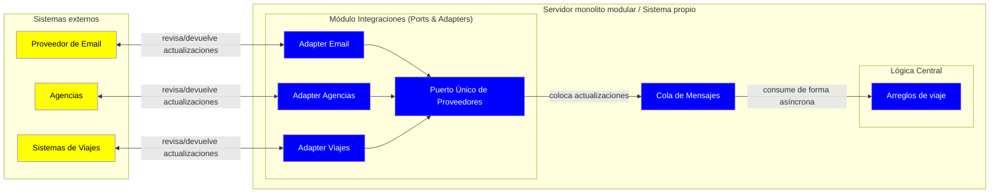

# Iteración 2 - Integraciones externas de "Trotamundos"

## PASO 2 - Objetivo de la Iteración
Diseñar el módulo de las integraciones externas definido en la iteración 1, como se obtendrá informacion de terceros y como entregarla al nucleo central.

**Drivers a desarrollar en la iteración:**
- US01 - Dashboard
- QA01 - Presentar actualizaciones
- QA04 - Inactividad no planificada
- QA14 - APIs estándar
- QA15 - Proveedor email

## PASO 3 - Descomposición
Hay que refinar es el módulo Integraciones externas. Actualmente, es el modulo que se comunica con el exterior y presenta mas incertidumbre y dificultad para el equipo.

## PASO 4 - Aplicando conceptos de diseño a los drivers seleccionados

**Alternativas propuestas:**

| Alternativa | Pros | Contras | Drivers relacionados
|---|---|---|---|
| Ports and Adapters | Independencia de la tecnología, modificabilidad, interoperabilidad | Complejidad de diseño (muchas abstracciones e indirecciones) | QA14, QA15
| Pub-Sub | Bajo acoplamiento, notificación a varios consumidores | Pérdida de consistencia, baja trazabilidad, buffer como punto único de falla. Con un solo consumidor no aporta nada | QA01, QA04 (Negativo) 
| Cola de mensajes punto a punto | Desacopla productor y consumidor | Agrega un componente y consistencia eventual (Asincronismo) | QA01 | 
| Pipes and filters  | Modular y modificable, reultilización, bajo acoplamiento | Bajo rendimiento (overhead latencia), degrada la interactividad con el usuario | QA14, QA15, QA01(negativo)

### 4.1 - Presentación y tolerancia a fallo
El asincronismo permite una mejor disponibilidad en el dashboard, este mecanismo lo proveé la cola y Pub-Sub, aunque este segundo es un estilo que no aplica al contexto ya que el subscriber será unicamente el sistema. (Se elige cola de mensajes punto a punto).

### 4.2 - Trabajo con proveedores externos
Necesitamos un mecanismo ligero pero robusto que permita foratear las entradas según un modelo unificado para que la lógica lo consuma sin depender del exterior. Ports&Adapters es la mejor alternativa considerada para cumplir con la independencia tecnologica de trabajar con distintos proveedores.

## PASO 5 - Instanciar elementos, asignar responsabilidades y definir interfaces
El módulo integraciones externas se estructura con Ports and Adapters que expone un único puerto de proveedores externos y un adapter por tipo de proveedor (email, agencias, sistemas de viajes).
El middleware que recibe las actualizaciones de los sistemas externos coloca estas actualizaciones en la cola para luego ser consumidos por la lógica central del sistema de forma asincrona

## PASO 6 - Vistas

Vista C&C:

- Azul: Sistema propio
- Amarillo: Sistemas externos

## PASO 7 - Revisar la aplicación del método

Se refinó el módulo más crítico en performance e interoperabilidad con terceros. Se concentra toda la comunicación en este modulo, asilando el resto del sistema de los mismos. Falta definir con que intervalo de tiempo hará las consultas el middleware para asegurar los tiempos requeridos por los escenarios. Consideramos que lo mas critico proximo es el ambito de la escalabilidad del sistema.
