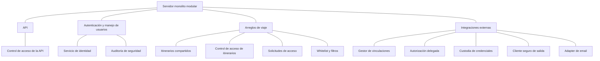
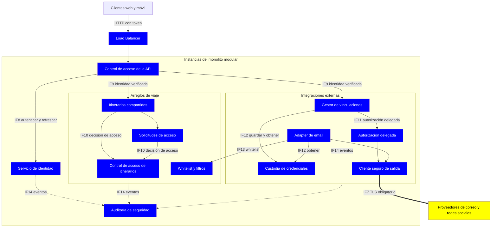
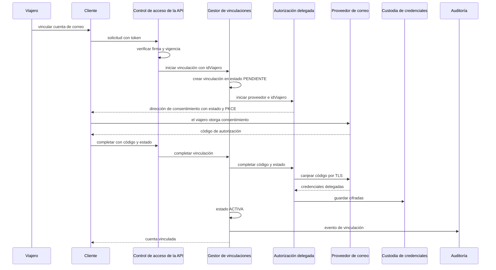
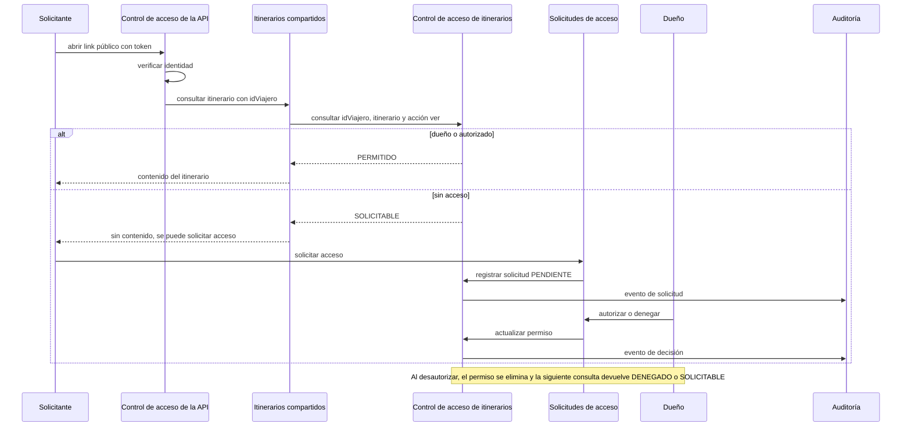

# Iteración 4 – Paso 2: Establecer la meta de la iteración seleccionando drivers

## Meta de la iteración

**Incorporar autenticación, autorización y protección del acceso al correo, de modo que el sistema pueda vincular cuentas de correo de forma segura y controlar quién ve los itinerarios compartidos.**

## Drivers seleccionados

| Driver | Tipo | Prioridad (Imp., Dif.) | Escenario / Medida clave | Por qué se incluye |
| --- | --- | --- | --- | --- |
| **QA08** Acceso email | Security | H, L | 100% de conexiones cifradas con el proveedor de correo | Objetivo indicado. Dificultad baja, y es prerrequisito de QA15 |
| **QA15** Proveedores email | Interoperability | H, H | Usuario validado y sincronizado en el 90% de los casos | Objetivo indicado. Falta definir autenticación y sincronización de cuentas |
| **QA09** Itinerarios compartidos | Security | H, M | 0 accesos no autorizados, 100% de autorizados permitidos | Objetivo indicado. Solo personas autorizadas ven los itinerarios |
| **US07** Compartir reservas | Funcional | Secundaria | Itinerarios compartidos, link público, solicitudes de acceso, autorizar y desautorizar | Es la historia asociada a QA09, que no se puede diseñar sin ella |
| **US02** Detección automática | Funcional | Alta | Escaneo del correo vía API del proveedor | Ya cubierta parcialmente en la iteración 2. Se completa con la vinculación autenticada de cuentas |
| **US03** Filtros y whitelists | Funcional | Secundaria | Whitelist de remitentes confiables | Complementa a QA08 y QA15: limita qué correos se leen y procesan |
| **QA16** Proveedores redes | Interoperability | L, M | Sincronización en el 70% de los casos | Comparte con QA15 el mismo problema (autorización delegada con un tercero). Puede resolverse con el mismo mecanismo |

## Justificación de la selección

- **Cohesión**: los tres escenarios objetivo giran en torno a **identidad, confianza y autorización**. Un mismo conjunto de decisiones (autenticación, delegación con terceros, control de acceso) puede abordarlos juntos.
- **Dependencias**: QA15 requiere QA08 (no hay vinculación de correo sin un canal seguro), y QA09 requiere una identidad confiable del viajero. Además, el punto abierto 7 de `Architecture.md` (autenticación sin estado o sesión compartida con el load balancer) queda naturalmente dentro de esta meta.
- **Valor para el prototipo**: se cierran dos drivers de importancia alta (QA08, QA09), con dificultad baja y media, y se reduce el riesgo de QA15, que es H/H.
- **Alcance acotado**: se agregan solo US03 y QA16 por su afinidad. Se dejan fuera QA04 (disponibilidad), QA03, QA02, QA11 y QA12 para próximas iteraciones.

# Iteración 4 – Paso 3: Elegir elementos del sistema a refinar

El sistema ya no es greenfield: tiene decisiones previas (iteraciones 1 a 3). Por eso los elementos candidatos son los resultantes de esas iteraciones, y la iteración se aborda con un enfoque **top-down**, refinando elementos existentes y agregando los mínimos necesarios para la meta.

## Elementos seleccionados

| # | Elemento a refinar | Qué se refinará | Drivers que motivan |
| --- | --- | --- | --- |
| E1 | **Autenticación y manejo de usuarios** | Mecanismo de autenticación y de autorización, y cómo se propaga la identidad a través del load balancer | QA09, QA08, QA16 |
| E2 | **Módulo Integraciones externas, Adapter de email** | Vinculación de cuentas de correo (autorización delegada), custodia de credenciales, canal cifrado y sincronización | QA08, QA15, US02 |
| E3 | **Arreglos de viaje** | Itinerarios compartidos, solicitudes de acceso, whitelist y filtro de remitentes | QA09, US07, US03 |
| E4 | **API** | Punto de aplicación de la autorización sobre cada operación | QA09 |

## Justificación

- **E1 y E2 concentran el riesgo**: QA15 es H/H y QA08 es prerrequisito. Ambos dependen de cómo se obtiene y se protege la autorización del viajero ante un tercero.
- **E3 y E4 son donde se hace cumplir QA09**: la medida "0 accesos no autorizados" exige un punto de decisión de acceso claro y que ninguna ruta lo evite.
- **No se crean elementos nuevos todavía**: se decide en el Paso 5 si hace falta instanciar alguno (por ejemplo, un componente de autorización o de custodia de credenciales) según los conceptos de diseño que se elijan en el Paso 4.

# Iteración 4 - Paso 4: Elegir conceptos de diseño

Consulté el catálogo de tácticas de seguridad (cap. 11) y de integrabilidad (cap. 7) de Bass, Clements y Kazman.

## Conceptos de diseño considerados

### Estilos arquitectónicos

| # | Estilo | Elementos | Drivers | Rol en la iteración |
| --- | --- | --- | --- | --- |
| S1 | **Ports and Adapters** (extensión del ADR05) | E2 | QA15, QA16, QA08, CN1 | Se extiende con un puerto de autorización delegada, con un adapter por proveedor (correo, redes). El núcleo no conoce los detalles de cada proveedor |
| S2 | **Intercepting Validator / filtro de seguridad en la API** (patrón de seguridad de Bass) | E4, E1 | QA09 | Todo request pasa por un único punto de autenticación y autorización antes de llegar a Arreglos de viaje. Ninguna ruta lo evita |

### Tácticas arquitectónicas

| # | Táctica | Categoría | Elementos | Drivers |
| --- | --- | --- | --- | --- |
| T1 | **Authenticate actors** con tokens firmados de vida corta y refresh (sin estado en el servidor) | Resist (Seguridad) | E1, E4 | QA09, punto abierto 7 |
| T2 | **Authorize actors** con control de acceso por recurso (dueño, autorizado, solicitante pendiente) | Resist (Seguridad) | E3, E4 | QA09, US07 |
| T3 | **Limit exposure**: el link público solo habilita crear una solicitud de acceso, nunca ver el contenido | Resist (Seguridad) | E3 | QA09, US07 |
| T4 | **Encrypt data**: TLS en todo el tráfico con el proveedor de correo, y cifrado de las credenciales delegadas guardadas | Resist (Seguridad) | E2 | QA08 |
| T5 | **Revoke access** y **Audit**: revocar la vinculación de una cuenta o el acceso a un itinerario, y registrar accesos y decisiones de autorización | React / Recover (Seguridad) | E1, E2, E3 | QA09, QA08 |
| T6 | **Adhere to standards** (OAuth 2.0 y OpenID Connect) más **Abstract common services** (un solo puerto de autorización delegada para correo y redes) | Limit dependencies (Integrabilidad) | E2 | QA15, QA16, CN1 |

### Arquitecturas de referencia y componentes externos

- **Arquitecturas de referencia**: ninguna aplica. Las existentes (por ejemplo, un API Gateway completo) agregan más infraestructura de la que el prototipo necesita.
- **Componentes externos**: solo estándares abiertos (OAuth 2.0 y OIDC, TLS). No se fija un proveedor de identidad ni de gestión de secretos, para respetar CN1. La custodia de secretos se accede mediante una interfaz genérica.

# Iteración 4 - Paso 5: Instanciar elementos, asignar responsabilidades y definir interfaces

## 1. Instanciación de elementos

Cada elemento nuevo o modificado nace de una táctica concreta.

| Elemento | Padre | Estado | Táctica que lo origina |
| --- | --- | --- | --- |
| **Servicio de identidad** | E1 | Nuevo | T1 Authenticate actors, T5 Revoke access |
| **Auditoría de seguridad** | E1 | Nuevo | T5 Audit |
| **Control de acceso de la API** | E4 | Nuevo | T1, T2 |
| **Itinerarios compartidos** | E3 | Nuevo | US07 |
| **Control de acceso de itinerarios** | E3 | Nuevo | T2 Authorize actors, T3 Limit exposure |
| **Solicitudes de acceso** | E3 | Nuevo | T3, T5 |
| **Whitelist y filtros** | E3 | Nuevo | US03, limit exposure |
| **Gestor de vinculaciones** | E2 | Nuevo | QA15, T5 |
| **Autorización delegada** (puerto y adapters por proveedor) | E2 | Nuevo | T6 Adhere to standards y Abstract common services |
| **Custodia de credenciales** | E2 | Nuevo | T4 Encrypt data |
| **Cliente seguro de salida** | E2 | Nuevo | T4 Encrypt data |
| Adapter de email | E2 | Modificado | US02, US03, QA15 |

## 2. Asignación de responsabilidades

### E1: Autenticación y manejo de usuarios

| Elemento | Responsabilidades |
| --- | --- |
| **Servicio de identidad** | Registrar y autenticar al viajero. Emitir un token de acceso firmado de vida corta y un token de refresco. Rotar y revocar tokens de refresco (cierre de sesión, sospecha de abuso). Publicar el material necesario para que cualquier instancia verifique las firmas |
| **Auditoría de seguridad** | Registrar eventos de seguridad: login, accesos a itinerarios, decisiones de autorización, vinculación y desvinculación de cuentas. Solo escritura desde los demás elementos. Consulta restringida |

### E4: API

| Elemento | Responsabilidades |
| --- | --- |
| **Control de acceso de la API** | Verificar la firma y la vigencia del token en **cada** request, sin consultar estado compartido. Rechazar lo no autenticado. Extraer el `idViajero` verificado y propagarlo como contexto de identidad. Es la única entrada de operaciones hacia Arreglos de viaje y Integraciones, por lo que no hay ruta sin identidad verificada |

### E3: Arreglos de viaje

| Elemento | Responsabilidades |
| --- | --- |
| **Itinerarios compartidos** | Crear y eliminar itinerarios. Agregar y quitar reservas. Generar el link público con un identificador no adivinable |
| **Control de acceso de itinerarios** | Único punto de decisión sobre quién puede ver o modificar un itinerario. Resuelve el rol del solicitante (dueño, autorizado, pendiente, sin acceso). **Deniega por defecto**. Los permisos se leen vigentes en cada decisión y no viajan dentro del token |
| **Solicitudes de acceso** | Crear solicitudes desde el link público (el link solo habilita pedir acceso). Autorizar, denegar y desautorizar. Revocar efectivamente al desautorizar |
| **Whitelist y filtros** | Mantener la whitelist de remitentes del viajero. Filtrar reservas por fecha, destino y remitente. Ocultar reservas de viajes completados. Exponer la whitelist vigente a Integraciones |

### E2: Integraciones externas

| Elemento | Responsabilidades |
| --- | --- |
| **Gestor de vinculaciones** | Mantener el estado de cada cuenta vinculada: `PENDIENTE`, `ACTIVA`, `REQUIERE_REVINCULAR`, `REVOCADA`. Coordinar alta, renovación y baja de la vinculación. Registrar el último escaneo. Avisar al viajero cuando una cuenta requiere acción |
| **Autorización delegada** | Un único puerto para el flujo OAuth 2.0 con consentimiento del viajero (código de autorización con PKCE) y OIDC cuando haga falta identificar la cuenta. Un adapter por proveedor traduce los endpoints y alcances propios de cada uno. Sirve a correo y a redes sociales |
| **Custodia de credenciales** | Guardar, entregar y eliminar tokens delegados, siempre cifrados. Solo el módulo Integraciones puede pedirlos. Las claves y el almacén quedan detrás de una interfaz genérica |
| **Cliente seguro de salida** | Único camino de salida hacia proveedores. Exige TLS con validación de certificados. Rechaza conexiones sin cifrar y no ofrece opción para desactivarlo |
| **Adapter de email** (ajuste) | Usar las vinculaciones activas para escanear. Aplicar la whitelist **antes** de normalizar y descartar lo que no pasa el filtro. Clasificar el rechazo de autorización como error específico |

## 3. Definición de interfaces

### Interfaces nuevas

| ID | Interfaz | Productor | Consumidor | Tipo | Contrato (resumen) | Táctica |
| --- | --- | --- | --- | --- | --- | --- |
| IF8 | Autenticación | Servicio de identidad | Control de acceso de la API | Síncrona, interna | Registrar, autenticar, refrescar, revocar. Devuelve token de acceso con vida corta y token de refresco rotativo | T1 |
| IF9 | Contexto de identidad | Control de acceso de la API | Arreglos de viaje e Integraciones | Interna, parámetro obligatorio | `idViajero` verificado y expiración. Toda operación lo exige y no se acepta una identidad enviada por el cliente | T1 |
| IF10 | Decisión de acceso a itinerario | Control de acceso de itinerarios | API y operaciones de Itinerarios | Síncrona, interna | `consultar(idViajero, idItinerario, acción)` devuelve `PERMITIDO`, `DENEGADO` o `SOLICITABLE`. `SOLICITABLE` solo habilita crear solicitud | T2, T3 |
| IF11 | Autorización delegada | Gestor de vinculaciones | Adapters (correo, redes) | Interna | `iniciar(proveedor, idViajero)` devuelve la dirección de consentimiento. `completar(código, estado)`, `renovar`, `revocar`, `estado`. Neutral al proveedor | T6 |
| IF12 | Custodia de credenciales | Custodia | Módulo Integraciones | Interna | `guardar`, `obtener`, `eliminar` por vinculación. Los valores nunca salen en claro del módulo | T4 |
| IF13 | Configuración de escaneo | Whitelist y filtros | Adapter de email | Interna, consulta | Whitelist vigente del viajero. Supuesto: sin whitelist definida se procesan los correos clasificados como de viaje | US03 |
| IF14 | Evento de auditoría | Cualquier elemento de seguridad | Auditoría de seguridad | Asíncrona, solo escritura | Quién, qué acción, sobre qué recurso, resultado, instante | T5 |

### Interfaces existentes que cambian

| ID | Cambio |
| --- | --- |
| IF1 API de clientes | Toda operación lleva el token de acceso. Se agregan operaciones de autenticación, itinerarios compartidos, solicitudes de acceso, whitelist y vinculación de cuentas. El link público solo admite crear una solicitud |
| IF2 Puerto de proveedores | Opera sobre una vinculación activa. Agrega el error clasificado `AUTORIZACION_INVALIDA`, que lleva la vinculación a `REQUIERE_REVINCULAR` |
| IF6 Estado de proveedor | Agrega el evento "vinculación requiere acción del viajero", distinto de "proveedor degradado" |
| IF7 Proveedores externos | Todo tráfico sale por el Cliente seguro de salida con TLS obligatorio |

## 4. Justificación

**Instanciación**
- La identidad vive en un servicio dentro del monolito. No se agregan unidades desplegables, coherente con el supuesto del prototipo.
- Verificar el token en cada request elimina la necesidad de sesión compartida entre instancias detrás del load balancer.
- **Separar identidad de permisos**: el token solo dice quién es el viajero y los permisos se consultan vigentes. Así desautorizar (US07) surte efecto de inmediato y no depende de la expiración del token. Costo: una decisión de acceso por operación sobre itinerarios.

**Responsabilidades**
- **Un único punto de decisión por recurso** (Control de acceso de itinerarios) acerca QA09 a "0 accesos no autorizados", porque la regla no se reparte entre operaciones. La API garantiza identidad y Arreglos de viaje garantiza permisos.
- **Un solo camino de salida** (Cliente seguro de salida) hace que QA08 sea verificable por construcción y no por disciplina en cada adapter.
- **Una vinculación con estados explícitos** es lo que permite medir QA15 (usuario validado y sincronizado) y reaccionar cuando el proveedor revoca el permiso.
- **El mismo puerto de autorización delegada** sirve a correo y a redes sociales (QA16) sin diseño adicional.
- **La whitelist se aplica en el adapter**, antes de normalizar, para procesar y retener menos datos del correo del viajero.

**Interfaces**
- IF9 impide que el cliente declare su propia identidad.
- IF10 devuelve `SOLICITABLE` como resultado propio, para que "pedir acceso" no filtre contenido del itinerario.
- IF11 y IF12 aíslan el protocolo y el almacén de secretos de la lógica central, en línea con CN1.

## 5. Trazabilidad contra los drivers

| Driver | Elementos e interfaces |
| --- | --- |
| QA08 | Cliente seguro de salida, Custodia de credenciales, IF7, IF12 |
| QA15 | Gestor de vinculaciones, Autorización delegada, IF2, IF6, IF11 |
| QA09 | Control de acceso de la API, Control de acceso de itinerarios, Solicitudes de acceso, IF9, IF10, IF14 |
| QA16 | Autorización delegada, IF11 |
| US02 | Adapter de email, Gestor de vinculaciones |
| US03 | Whitelist y filtros, Adapter de email, IF13 |
| US07 | Itinerarios compartidos, Solicitudes de acceso, Control de acceso de itinerarios, IF1 |

## 6. Supuestos para validar

- Vida del token de acceso de pocos minutos y refresco rotativo con vida mayor. Los valores exactos se calibran más adelante.
- La lectura de permisos para cada decisión de acceso debe reflejar el estado vigente. Se evalúa en el Paso 7.
- Sin whitelist definida, el escaneo procesa los correos clasificados como de viaje (IF13).

# Iteración 4 - Paso 6: Bosquejar vistas y registrar decisiones de diseño

Se agregan **4 vistas nuevas** (5.6 a 5.9) a la sección 5 de `Architecture.md`. Además se registran **6 ADR** (ADR12 a ADR17) en formato MADR, a continuar la numeración vigente.

## 1. Vistas

| Vista | Tipo | Qué ayuda a razonar | Drivers |
| --- | --- | --- | --- |
| 5.6 Descomposición de seguridad | Módulos | Dónde vive cada responsabilidad nueva | QA08, QA09, QA15 |
| 5.7 Seguridad y vinculación | C&C | Cómo se verifica la identidad, se decide el acceso y se sale hacia proveedores | QA08, QA09, QA15, QA16 |
| 5.8 Vinculación de cuenta de correo | Secuencia | Flujo de autorización delegada y custodia de credenciales | QA15, QA08 |
| 5.9 Acceso a itinerario compartido | Secuencia | Flujo de solicitud, autorización y revocación | QA09, US07 |

### 5.6 Vista de descomposición: seguridad

Refina los módulos de la vista 5.1 con los elementos instanciados en el Paso 5.

### 5.7 Vista C&C: seguridad y vinculación

Todo request entra por el Control de acceso de la API, que verifica el token localmente y propaga la identidad. Las decisiones sobre itinerarios se toman en un único punto. Todo tráfico hacia proveedores sale por el Cliente seguro de salida.

- Azul: Sistema propio
- Amarillo: Sistemas externos

### 5.8 Secuencia: vinculación de una cuenta de correo

El sistema nunca ve la contraseña del viajero. Recibe un permiso delegado, acotado y revocable.

### 5.9 Secuencia: acceso a un itinerario compartido

El link público solo habilita pedir acceso. La decisión se consulta vigente en cada operación.

## 2. Registro de decisiones (MADR)

### ADR12 - Tokens firmados de vida corta para autenticar al viajero

- **Estado**: Aceptada
- **Iteración**: 4
- **Drivers**: QA09, QA04, QA06, QA07, punto abierto 7 de `Architecture.md`

**Contexto y problema**
Con N instancias del monolito detrás del load balancer (ADR08), hay que identificar al viajero en cada request sin atarlo a una instancia ni crear otro punto único de falla.

**Opciones consideradas**
1. Tokens de acceso firmados de vida corta, con token de refresco rotativo.
2. Sesión en memoria con sticky sessions.
3. Sesión en un almacén compartido consultado en cada request.

**Resultado de la decisión**
Opción 1, con la verificación de firma local en cada instancia.

**Consecuencias**
- Bueno: cualquier instancia valida sin consultar estado compartido. No agrega puntos únicos de falla. Escala con el balanceo.
- Malo: la revocación inmediata de un token de acceso no es posible, solo por expiración. La rotación de claves de firma exige gestión.
- Mitigación: vida corta del token de acceso, y revocación del refresco en el servicio de identidad.

**Pros y contras de las alternativas**
- Sticky sessions: simple, pero debilita el balanceo y pierde la sesión si cae la instancia.
- Almacén compartido de sesión: revocación inmediata, pero agrega un componente crítico y una consulta por request.

### ADR13 - Control de acceso por recurso, con permisos fuera del token y denegación por defecto

- **Estado**: Aceptada
- **Iteración**: 4
- **Drivers**: QA09, US07

**Contexto y problema**
La medida es 0 accesos no autorizados y 100% de autorizados permitidos. Los permisos cambian (autorizar, desautorizar) y el cambio debe surtir efecto de inmediato.

**Opciones consideradas**
1. Un punto de decisión por recurso (Control de acceso de itinerarios), con permisos leídos vigentes. El link público solo permite solicitar acceso.
2. Permisos incluidos en el token.
3. Link secreto que da acceso directo al contenido.
4. Decisión repartida dentro de cada operación.

**Resultado de la decisión**
Opción 1. La API garantiza identidad verificada y Arreglos de viaje garantiza permisos. Se deniega por defecto. La consulta devuelve `PERMITIDO`, `DENEGADO` o `SOLICITABLE`.

**Consecuencias**
- Bueno: la regla vive en un solo lugar y es auditable. Desautorizar surte efecto en la siguiente consulta. Pedir acceso no expone contenido.
- Malo: una consulta de permisos por operación sobre itinerarios, con costo en latencia.
- A vigilar: los permisos no deben servirse desde una caché que ignore revocaciones. Se analiza en el Paso 7.

**Pros y contras de las alternativas**
- Permisos en el token: no hay consulta extra, pero los permisos quedan vigentes hasta que expire el token, lo que contradice QA09.
- Link secreto: simple, pero quien obtenga el link accede, lo que contradice US07.
- Decisión repartida: es fácil olvidarla en una operación nueva.

### ADR14 - Autorización delegada OAuth 2.0 mediante un puerto único

- **Estado**: Aceptada
- **Iteración**: 4
- **Drivers**: QA15, QA16, QA08, CN1

**Contexto y problema**
El sistema debe leer el correo del viajero y, más adelante, conectarse a redes sociales, sin depender de un proveedor específico y sin custodiar contraseñas.

**Opciones consideradas**
1. OAuth 2.0 con código de autorización y PKCE, y OIDC cuando se necesite identificar la cuenta. Un puerto único con un adapter por proveedor, y un Gestor de vinculaciones con estados `PENDIENTE`, `ACTIVA`, `REQUIERE_REVINCULAR`, `REVOCADA`.
2. Usuario y contraseña del viajero guardados.
3. Integración ad hoc por proveedor.

**Resultado de la decisión**
Opción 1.

**Consecuencias**
- Bueno: permisos acotados y revocables, sin ver contraseñas. Sumar un proveedor es agregar un adapter. El mismo mecanismo sirve para correo y redes.
- Malo: dependencia del flujo de consentimiento de cada proveedor. Los tokens de refresco pueden caducar o ser revocados, así que hay que atender el estado `REQUIERE_REVINCULAR`.
- Medición: el estado de la vinculación permite medir "validado y sincronizado" de QA15.

**Pros y contras de las alternativas**
- Contraseñas guardadas: máxima exposición ante una filtración, contra QA08.
- Integración ad hoc: rápida al inicio, pero no escala y rompe CN1.

### ADR15 - Cliente seguro de salida con TLS obligatorio y custodia cifrada de credenciales

- **Estado**: Aceptada
- **Iteración**: 4
- **Drivers**: QA08

**Contexto y problema**
QA08 exige 100% de conexiones cifradas con el proveedor de correo y protección frente a un atacante intermediario. Además, las credenciales delegadas son sensibles.

**Opciones consideradas**
1. Un único camino de salida con TLS obligatorio y validación de certificados, sin opción de desactivarlo. Credenciales cifradas en reposo y accesibles solo desde Integraciones, tras una interfaz genérica.
2. TLS configurable por adapter.
3. Cifrar solo el tráfico considerado sensible.

**Resultado de la decisión**
Opción 1.

**Consecuencias**
- Bueno: el 100% de cifrado se cumple por construcción. Una filtración del almacenamiento no expone credenciales en claro.
- Malo: requiere gestión de claves y de certificados. Un proveedor sin TLS válido queda inaccesible.
- Nota: la interfaz genérica evita fijar un producto de gestión de secretos (CN1).

**Pros y contras de las alternativas**
- TLS por adapter: flexible, pero cada adapter puede olvidar o debilitar la protección.
- Cifrado parcial: deja brechas y no cumple la medida.

### ADR16 - Revocación y auditoría de seguridad

- **Estado**: Aceptada
- **Iteración**: 4
- **Drivers**: QA09, QA08, US07

**Contexto y problema**
Hay que poder quitar accesos (desautorizar, desvincular una cuenta, cerrar sesión) y demostrar que no hubo accesos indebidos.

**Opciones consideradas**
1. Revocación explícita en cada elemento (refresco, permiso, vinculación) y un registro de auditoría de solo escritura para eventos de seguridad.
2. Solo expiración natural, sin registro dedicado.

**Resultado de la decisión**
Opción 1. Los elementos emiten eventos por IF14 de forma asíncrona, para no sumar latencia al camino crítico.

**Consecuencias**
- Bueno: acciones de revocación efectivas y trazables. Permite investigar incidentes.
- Malo: volumen de eventos y política de retención a definir. El registro contiene datos sensibles y requiere acceso restringido.

**Pros y contras de las alternativas**
- Solo expiración: más simple, pero no hay forma de quitar acceso a tiempo ni de probar ausencia de accesos indebidos.

### ADR17 - Aplicar la whitelist en el adapter de email, antes de normalizar

- **Estado**: Aceptada
- **Iteración**: 4
- **Drivers**: US03, QA08, QA15

**Contexto y problema**
La whitelist de remitentes limita qué correos se procesan. Hay que decidir en qué punto del flujo se aplica.

**Opciones consideradas**
1. En el adapter de email, antes de normalizar, consultando la whitelist vigente por IF13.
2. En Arreglos de viaje, después de recibir el mensaje normalizado.

**Resultado de la decisión**
Opción 1. Supuesto: sin whitelist definida se procesan los correos clasificados como de viaje.

**Consecuencias**
- Bueno: se procesa y retiene menos contenido del correo del viajero, lo que reduce la exposición. También se ahorra trabajo de normalización.
- Malo: correos legítimos de remitentes fuera de la lista se ignoran. El adapter depende de una consulta a la whitelist.

**Pros y contras de las alternativas**
- Filtrar en Arreglos de viaje: el contenido ya fue leído y normalizado, y viaja por la cola sin necesidad.

# Iteración 4 - Paso 7: Análisis del diseño y revisión de la meta

Se analiza cada decisión por separado, luego el conjunto frente a la meta, y por último cuánto diseño llevamos y si hace falta otra iteración.

> **Meta de la iteración 4**: incorporar autenticación, autorización y protección del acceso al correo, de modo que el sistema pueda vincular cuentas de correo de forma segura y controlar quién ve los itinerarios compartidos.

## 1. Análisis por driver

Se recorren las tácticas de seguridad de Bass (detectar, resistir, reaccionar, recuperar) y las de integrabilidad aplicadas.

| Driver | Medida de respuesta | Cómo lo aborda el diseño | Evaluación |
| --- | --- | --- | --- |
| **QA08** Acceso email | 100% de conexiones cifradas | Cliente seguro de salida como único camino, TLS obligatorio con validación de certificados, y credenciales cifradas en reposo (ADR15) | **Abordado**. El 100% se cumple por construcción. Falta validar con prueba de que ningún adapter puede saltear el cliente |
| **QA15** Proveedores email | Validado y sincronizado en el 90% | Autorización delegada con OAuth 2.0 (ADR14), vinculación con estados explícitos y re-vinculación guiada | **Abordado con riesgos** (ver 3.1 y 3.2) |
| **QA09** Itinerarios compartidos | 0 accesos no autorizados, 100% de autorizados permitidos | Identidad verificada en la API (ADR12) y decisión única de acceso con denegación por defecto, permisos vigentes y link que solo permite solicitar (ADR13) | **Abordado**. Falta validar con pruebas de autorización (ver 3.3 y 3.4) |
| **QA16** Proveedores redes | Sincronizado en el 70% | Reutiliza el puerto de autorización delegada (ADR14) | **Parcial**. La conexión con redes queda cubierta. El flujo concreto de compartir hacia cada red no se diseñó |
| **US02** Detección automática | Escaneo vía API del proveedor | Adapter de email opera sobre vinculaciones activas | **Abordado** |
| **US03** Filtros y whitelists | Filtro por remitente y whitelist | Whitelist aplicada antes de normalizar (ADR17) | **Abordado**. El filtrado por fecha y destino es lectura sobre datos ya modelados |
| **US07** Compartir reservas | Itinerarios, link público, solicitudes, autorizar y desautorizar | Itinerarios compartidos, Solicitudes de acceso y Control de acceso de itinerarios (ADR13) | **Abordado** a nivel arquitectónico |

## 2. Análisis por decisión

| ADR | Fortaleza | Debilidad o costo | Sensitivity / tradeoff |
| --- | --- | --- | --- |
| ADR12 Tokens de vida corta | Sin estado compartido, escala con el balanceo | La revocación del token de acceso solo ocurre por expiración | **Tradeoff**: la vida del token equilibra seguridad (más corta) contra carga sobre el servicio de identidad (más refrescos) |
| ADR13 Control de acceso por recurso | Un solo punto de decisión, revocación inmediata | Una consulta de permisos por operación | **Sensitivity**: QA09 depende de que esa consulta nunca devuelva permisos viejos. **Tradeoff** con QA02 y QA06 por la latencia añadida |
| ADR14 OAuth con puerto único | Sin contraseñas, reutilizable para redes | Dependencia del consentimiento y de los tokens de cada proveedor | **Sensitivity**: QA15 depende de la tasa de refrescos que fallan |
| ADR15 TLS y custodia cifrada | QA08 cumplido por construcción | Gestión de claves y certificados | **Tradeoff**: un proveedor con certificado inválido queda inaccesible, se prioriza seguridad sobre disponibilidad |
| ADR16 Revocación y auditoría | Trazabilidad y revocación efectiva | Volumen de eventos y datos sensibles en el registro | Retención y acceso al registro por definir |
| ADR17 Whitelist en el adapter | Menos datos procesados y retenidos | Se ignoran correos válidos de remitentes no listados | Depende del supuesto de "sin whitelist, se procesa lo clasificado como viaje" |

## 3. Riesgos y puntos abiertos que deja el diseño

| # | Riesgo | Por qué importa | Sugerencia |
| --- | --- | --- | --- |
| 3.1 | **Refresco concurrente de credenciales delegadas con N instancias**. Si dos instancias renuevan a la vez el mismo token y el proveedor rota el refresco, una puede invalidar la credencial de la otra y dejar la cuenta en `REQUIERE_REVINCULAR` sin culpa del viajero | Daña directamente la medida del 90% de QA15. Se suma al punto abierto 1 (el polling podría ejecutarse N veces) | Definir un único responsable de renovar cada vinculación (instancia designada o partición por viajero). Resolverlo junto con el punto abierto 1 |
| 3.2 | **Revocación o caducidad del permiso por el proveedor**. El viajero puede retirar el acceso desde su cuenta de correo | Las reservas dejan de actualizarse sin que el viajero lo note | El estado `REQUIERE_REVINCULAR` y el evento de IF6 ya lo cubren. Falta definir cuánto tarda en detectarse y cómo se avisa |
| 3.3 | **Permisos servidos con datos viejos**. Si la decisión de acceso se apoya en caché o réplicas con replicación asíncrona (puntos abiertos 5 y 6), una desautorización podría no verse de inmediato | Es el mayor riesgo para "0 accesos no autorizados" | Que la decisión de acceso lea siempre el estado vigente, sin pasar por caché. Validar con una prueba de desautorización seguida de lectura |
| 3.4 | **Abuso del link público**. Enumeración de identificadores y spam de solicitudes de acceso al dueño | Sin límites, un atacante puede molestar al dueño o intentar adivinar links | Identificador no adivinable (ya previsto) y límite de solicitudes por solicitante e itinerario. Esta táctica (restrict login / limit access) no se incluyó en la iteración |
| 3.5 | **Claves de firma de tokens**. Su rotación y custodia | Una clave comprometida invalida ADR12 y ADR13 | Rotación periódica y custodia con la misma interfaz genérica de ADR15 |
| 3.6 | **Fallas de nuevos componentes**. Custodia de credenciales y Auditoría pasan a ser dependencias del camino de escaneo y de la vinculación | Sin custodia no se puede escanear. Es relevante para QA04 | Que la falla de Auditoría nunca bloquee una operación (IF14 es asíncrona). Tratar la Custodia como componente crítico en una iteración de disponibilidad |
| 3.7 | **Cobertura de las tácticas de detección**. Se cubren resistir, reaccionar y recuperar. Detectar anomalías (intentos repetidos de login, accesos inusuales) quedó solo como registro | Para un prototipo es aceptable | Reevaluar si el producto sale del prototipo |

## 4. Evaluación del conjunto

| Pregunta | Respuesta |
| --- | --- |
| ¿Se cumplió la meta? | **Sí, a nivel de diseño**. Hay un mecanismo definido de identidad, otro de autorización por recurso y otro de vinculación segura de correo. Quedan los riesgos 3.1 y 3.3 como los de mayor impacto |
| ¿Los drivers seleccionados quedaron cubiertos? | QA08, QA09, QA15, US02, US03 y US07 **abordados**. QA16 **parcial** |
| ¿El diseño es coherente con lo previo? | Sí. No se agregan unidades desplegables ni se modifican los ADR vigentes. Se respeta CN1 con estándares abiertos y interfaces genéricas |
| ¿Quedan consecuencias para otros drivers? | Latencia añadida por la decisión de acceso (QA02, QA06) y nuevos componentes críticos (QA04). Ninguna bloquea el prototipo |

## 5. Estado del backlog de la ronda

| Estado | Drivers |
| --- | --- |
| **Abordados** | QA01 (parcial), QA05, QA06, QA07, QA08, QA09, QA10 (parcial), QA13 (parcial), QA14, QA15, US01, US02, US03, US04, US07 |
| **Parciales** | QA04, QA16 |
| **Pendientes** | QA03, QA02, QA11, QA12, US05, US06, US08 |

Para el propósito de la ronda (un prototipo básico), las historias que concentran la propuesta de valor, **US01, US02, US03, US04 y US07**, ya tienen diseño. Quedan sin diseño US05, US06 y US08.