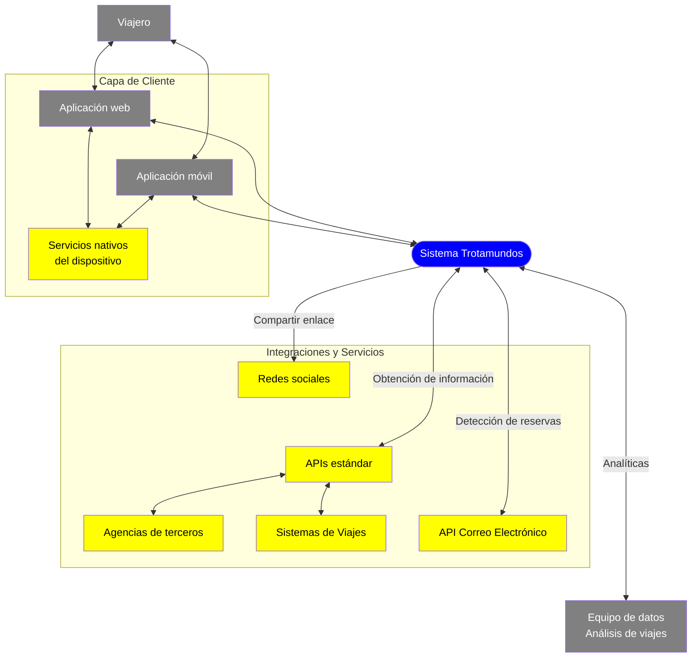
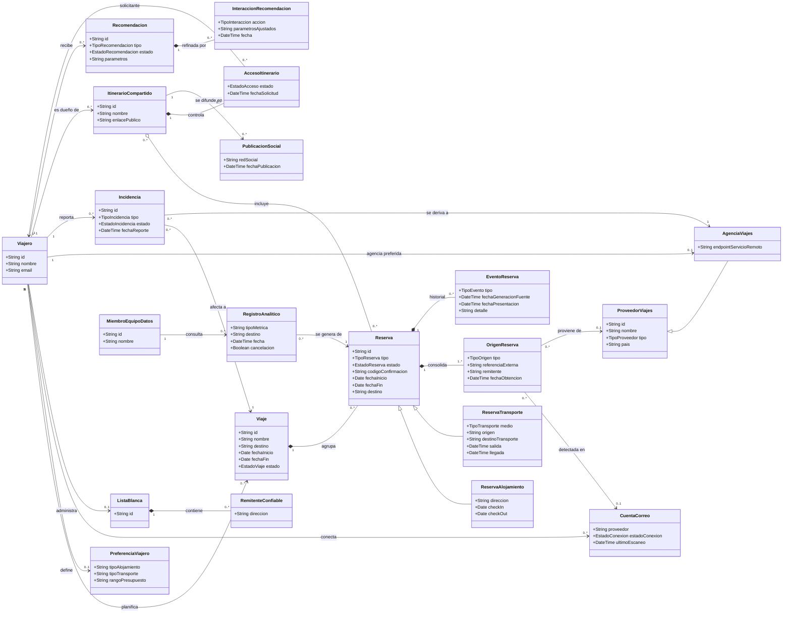
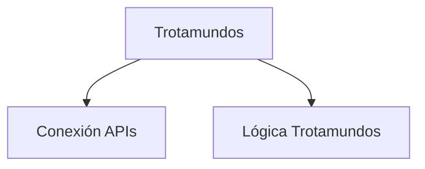
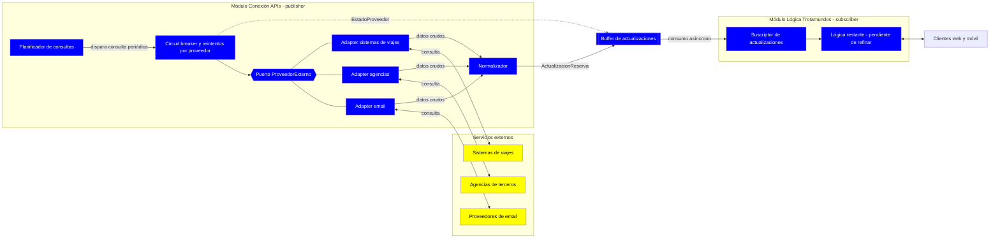
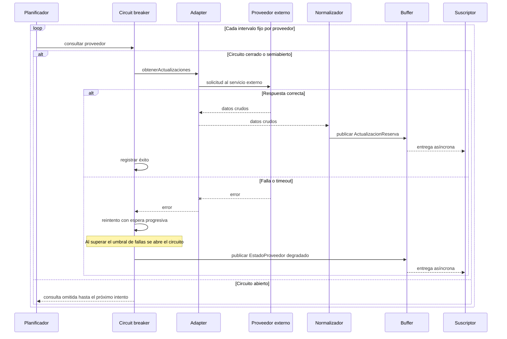
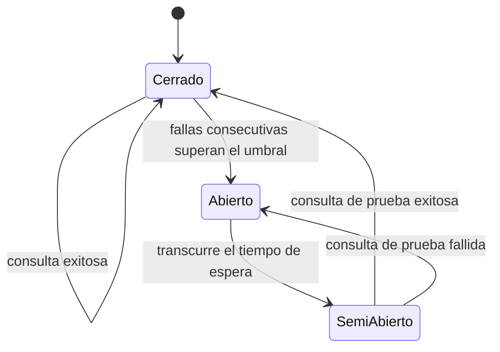

### 1.- Introduction

Este documento describe la arquitectura de **Trotamundos**, una plataforma que consolida en un único Dashboard centrado en el viaje las reservas del viajero (hoteles, autos, vuelos, trenes, buses) provenientes de agencias, sistemas de viajes y su bandeja de correo.

El diseño sigue el método ADD descrito en `ADD.md`. Esta primera ronda tiene como propósito producir el diseño necesario para construir un **prototipo básico** que permita a la startup evaluar la viabilidad del proyecto desde la perspectiva arquitectónica y de mercado. La ronda se organiza en 5 iteraciones (ver `IterationPlan.md`).

**Estado actual del documento**

| Iteración | Objetivo | Estado |
| --- | --- | --- |
| 1 | Estructuración inicial del sistema | **Completada** (esta versión) |
| 2 | Escalabilidad y rendimiento del núcleo | Pendiente |
| 3 | Pipeline de reservas, seguridad de acceso y extensibilidad | Pendiente |
| 4 | Colaboración, resolución de problemas y analítica | Pendiente |
| 5 | UX y recomendación (condicional) | Pendiente |

El documento es incremental: cada iteración agrega vistas, interfaces y decisiones. Las decisiones se registran como ADRs en formato MADR (constraint C2) y los elementos se definen mediante interfaces genéricas para no depender de tecnologías o proveedores específicos (concern de neutralidad tecnológica).

**Estructura:** 2) contexto, 3) drivers, 4) modelo de dominio, 5) diagramas, 6) interfaces, 7) decisiones de diseño.

### 2.- Context diagram

El diagrama muestra a **Trotamundos** como una caja negra y su relación con el entorno: el Viajero, que interactúa mediante una aplicación web o móvil (apoyadas en servicios nativos del dispositivo), y los sistemas externos con los que el sistema intercambia información (agencias y sistemas de viajes a través de APIs estándar, proveedores de correo, redes sociales) más el equipo de datos que consume analíticas. Delimita el alcance del sistema y deja explícitas las integraciones externas que condicionan las decisiones de esta ronda.

- Azul: Sistema propio
- Amarillo: Sistemas externos
- Gris: Actores

### 3.- Architectural drivers

Resumen de los drivers definidos en `ArchitecturalDrivers.md`, con su prioridad y la iteración del plan en la que se abordan. Importancia del negocio (I) y dificultad técnica (D): H = alta, M = media, L = baja.

#### 3.1.- Historias de usuario

| ID | Nombre | Resumen | Influencia en la arquitectura | Iteración |
| --- | --- | --- | --- | --- |
| US01 | Dashboard | Ver todas las reservas activas organizadas por viaje, en web y móvil, como única fuente de verdad, sin duplicados y con edición manual. | **Principal** (funcionalidad central del negocio) | 1 |
| US02 | Detección automática de reservas | Escanear periódicamente el correo vía API del proveedor y agregar reservas al Dashboard. | **Principal** (integración externa y sincronización) | 3 |
| US03 | Filtros y whitelists | Clasificar reservas por remitente, filtrar por fecha, destino y remitente, y definir remitentes confiables. | Secundaria | 3 |
| US04 | Integración con terceros | Mantener el Dashboard actualizado (altas, cambios, cancelaciones) mediante APIs estándar de sistemas de viajes y agencias. | **Principal** (APIs con distintos formatos) | 3 |
| US05 | Resolución de problemas | Integrar la agencia preferida y derivarle incidencias comunes mediante su servicio remoto. | Secundaria | 4 |
| US06 | Analítica de datos | Recopilar datos analíticos por reserva y exponerlos por una API de uso interno. | Secundaria | 4 |
| US07 | Compartir reservas | Itinerarios compartidos con enlace público, solicitud y control de acceso, e interoperabilidad con redes sociales. | Secundaria | 4 |
| US08 | Sistema de recomendación | Sugerir alternativas con bucle human-in-the-loop. | Secundaria | 5 |

#### 3.2.- Escenarios de atributos de calidad

Ordenados por prioridad (importancia y dificultad).

| ID | Atributo | Escenario y medida de respuesta | I | D | Iteración |
| --- | --- | --- | --- | --- | --- |
| QA01 | Performance | Presentar actualizaciones en el dashboard en menos de 5 minutos desde su generación en la fuente externa, en el 95% de los casos. | H | H | 1 |
| QA04 | Availability | Máximo 5 minutos de inactividad no planificada por mes, con detección en menos de 1 minuto. Si la falla es de un tercero, solo avisar al usuario. | H | H | 1 |
| QA07 | Scalability | Soportar picos de hasta 5 veces el promedio de uso, es decir 2500 req/s. | H | H | 2 |
| QA15 | Interoperability | Conectar un nuevo proveedor de correo; el usuario queda validado y sincronizado en el 90% de los casos. | H | H | 1 |
| QA06 | Scalability | 2 M de usuarios semanales activos y 500 req/s con 800 ms en el percentil 95. | H | M | 2 |
| QA14 | Interoperability | Integración con APIs estándar; respuestas 2xx en el 90% de los casos y parseables a términos del sistema. | H | M | 1 |
| QA13 | Integrability | Operar en otro país con menos de 15 persona-días y 0 cambios en la lógica central. | H | M | 3 |
| QA08 | Security | 100% de conexiones cifradas con el proveedor de correo. | H | L | 3 |
| QA05 | Scalability | 15 M de cuentas con 300 ms en el percentil 95 para lectura y escritura de cuentas. | H | L | 2 |
| QA09 | Security | 0 accesos no autorizados a itinerarios compartidos, 100% de los autorizados permitidos. | H | M | 4 |
| QA10 | Integrability | Integrar un nuevo medio de transporte con menos de 2 minutos de inactividad y menos de 10 persona-días. | H | M | 3 |
| QA03 | Performance | Primer contenido móvil en menos de 1.4 s en el 85% de los casos. | M | M | 2 |
| QA02 | Performance | Lectura del dashboard en 800 ms en el 95% de los casos. | M | L | 2 |
| QA11 | Usability | Dato buscado en menos de 10 s y al menos 90% de las tareas sin salir de la app. | M | L | 5 |
| QA16 | Interoperability | Conectar una nueva red social; sincronización en el 70% de los casos. | L | M | 4 |
| QA12 | Usability | 90% de datos obtenidos de servicios nativos sin ingreso manual, en menos de 3 s. | L | L | 5 |

#### 3.3.- Constraints

| ID | Descripción |
| --- | --- |
| C1 | Los viajeros deben usar el sistema desde una web o un dispositivo móvil. |
| C2 | Las decisiones se registran mediante ADRs en formato MADR y se utilizan contratos para un diseño y prototipo altamente trazables. |

#### 3.4.- Concerns

| ID | Descripción |
| --- | --- |
| CN1 | Utilizar tecnologías e interfaces genéricas para no depender de servicios específicos (neutralidad tecnológica). |

### 4.- Domain model

El modelo de dominio se deriva de las historias de usuario US01 a US08 y captura los conceptos de negocio de Trotamundos con un nivel de granularidad medio: se modelan las entidades principales, sus relaciones y las pocas especializaciones que tienen impacto arquitectónico. Las variantes finas (cada medio de transporte, cada red social, cada proveedor de correo) se representan como atributos de tipo en lugar de subclases, y los detalles de implementación (credenciales, auditoría, identificadores técnicos) quedan fuera.

#### 4.1.- Diagrama de clases

#### 4.2.- Descripción de los elementos

| Elemento                     | Tipo                    | Descripción                                                                                                                                                                                                                                                                                           | Historias de usuario    |
| ---------------------------- | ----------------------- | ----------------------------------------------------------------------------------------------------------------------------------------------------------------------------------------------------------------------------------------------------------------------------------------------------- | ----------------------- |
| **Viajero**                  | Entidad / actor         | Usuario final del sistema. Es el dueño de sus viajes, cuentas de correo, whitelist, itinerarios compartidos e incidencias. El volumen objetivo es de 15 millones de cuentas (QA05).                                                                                                                   | US01 a US05, US07, US08 |
| **PreferenciaViajero**       | Entidad                 | Preferencias explícitas del viajero (alojamiento, transporte, presupuesto) que, junto con su historial, alimentan el sistema de recomendación.                                                                                                                                                        | US08                    |
| **Viaje**                    | Entidad (agregado raíz) | Agrupa las reservas de un mismo desplazamiento. Es el eje de organización del Dashboard. Cuando finaliza, sus reservas dejan de mostrarse en la vista.                                                                                                                                                | US01, US03              |
| **Reserva**                  | Entidad                 | Arreglo de viaje individual (hotel, auto, vuelo, tren, bus). Es la unidad de verdad del Dashboard. Se puede crear manualmente, detectar desde correo o sincronizar desde un tercero.                                                                                                                  | US01 a US04, US07       |
| **ReservaAlojamiento**       | Especialización         | Reserva de hospedaje, con datos específicos de dirección y check-in/check-out.                                                                                                                                                                                                                        | US01                    |
| **ReservaTransporte**        | Especialización         | Reserva de transporte (vuelo, tren, bus, auto). El medio se modela como atributo `medio` para poder incorporar nuevos medios sin crear nuevas clases (QA10).                                                                                                                                          | US01, US04              |
| **OrigenReserva**            | Entidad                 | Registra cada fuente de la que proviene la información de una reserva: manual, correo o proveedor externo. Permite que una misma reserva tenga varias fuentes, para identificar duplicados y consolidarlos sin repetir. Para fuentes de correo guarda el remitente, que habilita filtros y whitelist. | US01, US02, US03, US04  |
| **EventoReserva**            | Entidad                 | Historial de cambios de una reserva (creación, actualización, cancelación) recibidos de las fuentes. Guarda la fecha de generación en la fuente y de presentación en el dashboard, necesarias para medir QA01. Es también insumo de la analítica de cancelaciones.                                    | US04, US06              |
| **CuentaCorreo**             | Entidad                 | Cuenta de correo conectada por el viajero a través de la API del proveedor. Guarda el estado de la conexión y la fecha del último escaneo. El proveedor es un atributo para mantener neutralidad tecnológica (QA15).                                                                                  | US02                    |
| **ListaBlanca**              | Entidad                 | Conjunto de remitentes de correo confiables definido por el viajero.                                                                                                                                                                                                                                  | US03                    |
| **RemitenteConfiable**       | Entidad                 | Dirección o dominio de correo incluido en la whitelist. Se usa para decidir qué correos se procesan.                                                                                                                                                                                                  | US03                    |
| **ProveedorViajes**          | Entidad                 | Sistema externo del que se obtiene información de reservas: aerolínea, hotel, rentadora o sistema de viajes, accesible vía API estándar. El país permite configurar proveedores locales (QA13).                                                                                                       | US04                    |
| **AgenciaViajes**            | Especialización         | Proveedor que además ofrece un servicio remoto de resolución de problemas. El viajero elige su agencia preferida.                                                                                                                                                                                     | US05                    |
| **Incidencia**               | Entidad                 | Problema común reportado por el viajero durante un viaje (atención médica, equipaje perdido, vuelo retrasado). Se deriva al servicio remoto de la agencia elegida.                                                                                                                                    | US05                    |
| **ItinerarioCompartido**     | Entidad                 | Grupo de reservas que el viajero decide compartir. Tiene un enlace público por defecto, pero el acceso real está controlado por autorización (QA09).                                                                                                                                                  | US07                    |
| **AccesoItinerario**         | Entidad                 | Relación entre un viajero y un itinerario ajeno. Su estado es Pendiente, Autorizado o Denegado. El dueño puede autorizar o desautorizar en cualquier momento.                                                                                                                                         | US07                    |
| **PublicacionSocial**        | Entidad                 | Registro de la difusión de un itinerario en una red social externa. La red se modela como atributo para sumar redes sin cambiar el modelo (QA16).                                                                                                                                                     | US07                    |
| **Recomendacion**            | Entidad                 | Sugerencia proactiva de alojamiento, transporte o ruta generada a partir del historial y las preferencias del viajero.                                                                                                                                                                                | US08                    |
| **InteraccionRecomendacion** | Entidad                 | Acción del viajero sobre una recomendación (aceptar, rechazar, ajustar parámetros). Es la base del bucle human-in-the-loop que refina nuevas sugerencias.                                                                                                                                             | US08                    |
| **RegistroAnalitico**        | Entidad                 | Dato analítico derivado de las reservas (tendencias, destinos, cancelaciones) para calcular monetización. Se expone mediante una API de uso interno.                                                                                                                                                  | US06                    |
| **MiembroEquipoDatos**       | Entidad / actor         | Usuario interno que consulta los registros analíticos.                                                                                                                                                                                                                                                | US06                    |

#### 4.3.- Decisiones de modelado y supuestos

- **Reserva consolidada con múltiples orígenes.** El criterio de "no duplicar y agregar la información" de US01 se resuelve separando la reserva lógica (`Reserva`) de sus fuentes (`OrigenReserva`). Trade-off: agrega una entidad y una regla de correlación, pero evita perder información al fusionar duplicados.
- **Especializaciones mínimas.** Solo se especializa `Reserva` en alojamiento y transporte, porque sus datos difieren de forma significativa. El resto de variantes (medio de transporte, tipo de proveedor, red social, proveedor de correo) son atributos o enumeraciones, lo que favorece QA10, QA15 y QA16 y evita dependencias con servicios específicos.
- **Filtros como consultas, no entidades.** El filtrado por fecha, destino y remitente (US03) se resuelve sobre atributos de `Reserva` y `OrigenReserva`; no requiere clases propias.
- **Multirregión.** Se representa solo mediante el atributo `pais` de `ProveedorViajes`. El resto de la configuración regional se tratará como configuración y no como parte del dominio (QA13).
- **Hipótesis a confirmar:** (1) un viajero tiene una sola agencia preferida a la vez; (2) los registros analíticos se anonimizan o seudonimizan antes de llegar al equipo de datos; (3) el sistema de recomendación consume el historial de `Reserva` y `EventoReserva`, sin entidades adicionales en esta primera ronda.

### 5.- Diagrams

Las vistas se incorporan a medida que avanzan las iteraciones. Esta versión contiene las de la **iteración 1**.

#### 5.1.- Iteración 1: descomposición de primer nivel (vista de módulos)

**Por qué esta vista:** al ser un sistema greenfield, la primera pregunta es en qué partes se divide el sistema y qué responsabilidad tiene cada una. Una vista de módulos (descomposición) es la apropiada para registrar esa partición antes de hablar de comportamiento en ejecución.

| Módulo | Responsabilidad | Estado de refinamiento |
| --- | --- | --- |
| **Conexión APIs** | Consultar a los servicios externos (proveedores de correo, agencias, sistemas de viajes), contener sus fallas, normalizar los datos y publicarlos en el buffer de actualizaciones. Actúa como **publisher** y concentra toda la comunicación con el exterior. | Definido en esta iteración |
| **Lógica Trotamundos** | Actúa como **subscriber** del buffer. Contiene el resto de la lógica del negocio (consolidación y deduplicación de reservas, Dashboard, filtros, itinerarios, etc.). | Pendiente. Es el módulo con mayor incertidumbre del sistema. |

#### 5.2.- Iteración 1: estructura en ejecución (vista de componentes y conectores)

**Por qué esta vista:** los drivers de la iteración (QA01, QA04, QA14, QA15) dependen de cómo fluyen los datos en ejecución, de qué es síncrono o asíncrono y de dónde se contienen las fallas. Eso se expresa en una vista de componentes y conectores, no en una de módulos. La estructura combina dos estilos en modo **overlay**: **Publisher-Subscriber** (conector asíncrono mediante un buffer) y **Ports & Adapters** (dentro del módulo Conexión APIs).

| Componente | Tipo | Responsabilidad |
| --- | --- | --- |
| Planificador de consultas | Componente | Dispara las consultas a cada proveedor a intervalos fijos (ADR-02). |
| Circuit breaker y reintentos | Táctica de disponibilidad | Aísla cada proveedor: reintentos acotados con espera progresiva y apertura del circuito ante fallas repetidas (ADR-04). |
| Puerto ProveedorExterno | Interfaz | Contrato único que abstrae a cualquier proveedor externo (ver sección 6). |
| Adapters | Componentes | Un adapter por tipo de proveedor. Traduce el protocolo y formato del tercero al puerto. |
| Normalizador | Componente | Convierte los datos crudos al formato canónico que espera la lógica, antes de publicarlos (ADR-03). |
| Buffer de actualizaciones | Conector / canal | Canal asíncrono entre publisher y subscriber (ADR-01). |
| Suscriptor | Componente | Punto de entrada de la lógica de negocio. Consume el buffer. |

**Notas de la vista**

- El flujo hacia la lógica es **unidireccional**: la lógica no se comunica con el exterior directamente (criterio de confirmación de ADR-01).
- Las consultas a los externos son **pull periódico** porque, en general, el tercero no puede notificar actualizaciones (contexto de ADR-02).
- La línea punteada `EstadoProveedor` es una **hipótesis de diseño** (ver 7.4): ADR-04 exige avisar al usuario cuando un proveedor falla, pero no define el mecanismo. Se propone reutilizar el mismo buffer para no abrir un segundo canal.

#### 5.3.- Iteración 1: ciclo de consulta y publicación (vista de secuencia)

**Por qué esta vista:** QA01 mide un tiempo de extremo a extremo y QA04 depende de qué ocurre cuando un proveedor falla. La secuencia deja visible el orden de las interacciones, dónde se consume el presupuesto de 5 minutos y dónde actúa el circuit breaker.

#### 5.4.- Iteración 1: ciclo de vida del circuit breaker (diagrama de estados)

**Por qué esta vista:** el comportamiento del circuit breaker es un autómata sencillo cuyos umbrales son el principal punto de ajuste (ADR-04). Un diagrama de estados lo comunica con menos ambigüedad que texto.

### 6.- Interfaces

Los contratos definen los límites entre elementos de forma independiente de la tecnología (constraint C2 y concern CN1). En la iteración 1 se definen las interfaces del módulo Conexión APIs. Las demás se agregarán al refinar la lógica y los clientes.

#### 6.1.- Puerto ProveedorExterno (Conexión APIs hacia los adapters)

Contrato que implementa cada adapter. El resto del módulo solo conoce este puerto, nunca al proveedor concreto (QA14, QA15).

| Operación | Entrada | Salida | Descripción |
| --- | --- | --- | --- |
| `obtenerActualizaciones` | Referencia a la fuente (cuenta de correo o proveedor), marca de tiempo o cursor desde la última consulta | Lista de registros crudos del proveedor | Consulta síncrona al servicio externo. Debe ser idempotente (consultar dos veces el mismo rango no genera efectos). |
| `verificarConexion` | Referencia a la fuente | Estado de conexión | Prueba liviana, usada por el circuit breaker en estado semiabierto. |
| `tipoProveedor` | n/a | Tipo (correo, agencia, sistema de viajes) | Identifica el adapter para ruteo y para el atributo de `OrigenReserva`. |

Errores del contrato: `ProveedorNoDisponible`, `TiempoAgotado`, `RespuestaInvalida`, `NoAutorizado`. Todo adapter debe traducir los errores del tercero a este conjunto cerrado, para que el circuit breaker no dependa de ningún proveedor.

#### 6.2.- Mensaje canónico ActualizacionReserva (Conexión APIs hacia buffer)

Formato homogéneo que produce el normalizador (ADR-03). La lógica no recibe datos crudos. Los campos se alinean con el modelo de dominio de la sección 4.

| Campo | Descripción | Entidad de dominio relacionada |
| --- | --- | --- |
| `idMensaje` | Identificador único del mensaje, para tolerar reentregas. | n/a |
| `viajeroId` | Viajero al que pertenece la información. | Viajero |
| `origen.tipo` | Manual, correo o proveedor externo. | OrigenReserva |
| `origen.referenciaExterna` | Identificador de la reserva en la fuente. Base para la deduplicación. | OrigenReserva |
| `origen.remitente` | Remitente, solo para fuentes de correo. | OrigenReserva |
| `proveedorId` | Proveedor o cuenta de correo de origen. | ProveedorViajes / CuentaCorreo |
| `tipoEvento` | Creación, actualización o cancelación. | EventoReserva |
| `fechaGeneracionFuente` | Momento en que la fuente generó el dato. Es el instante inicial para medir QA01. | EventoReserva |
| `fechaPublicacion` | Momento en que se publicó en el buffer. | n/a |
| `reserva.tipo` | Alojamiento o transporte. | Reserva |
| `reserva.medio` | Vuelo, tren, bus, auto (atributo, no subclase). | ReservaTransporte |
| `reserva.codigoConfirmacion`, `reserva.destino`, `reserva.fechaInicio`, `reserva.fechaFin` | Datos comunes de la reserva. | Reserva |
| `reserva.detalle` | Datos específicos según el tipo. | ReservaAlojamiento / ReservaTransporte |

#### 6.3.- Mensaje EstadoProveedor (circuit breaker hacia buffer)

| Campo | Descripción |
| --- | --- |
| `proveedorId` | Proveedor afectado. |
| `estado` | Operativo, degradado o no disponible. |
| `fecha` | Momento del cambio de estado. |
| `motivo` | Categoría del error del puerto. |

Permite a la lógica avisar al usuario (ADR-04) sin que el módulo Conexión APIs conozca a los clientes. Ver hipótesis H2 en 7.4.

#### 6.4.- Interfaz del buffer de actualizaciones (publisher y subscriber)

| Operación | Quién la usa | Descripción |
| --- | --- | --- |
| `publicar(mensaje)` | Conexión APIs | Agrega un `ActualizacionReserva` o `EstadoProveedor` al canal. |
| `suscribir(tipoMensaje)` | Lógica Trotamundos | Registra al suscriptor para recibir mensajes de un tipo. |
| `confirmar(idMensaje)` | Lógica Trotamundos | Confirma el procesamiento para evitar pérdidas. |

Garantías esperadas (a validar al elegir tecnología): entrega al menos una vez, orden por viajero y persistencia mientras el suscriptor no confirme. Se usa una interfaz genérica para cumplir CN1.

#### 6.5.- Interfaces pendientes

| Interfaz | Se define en |
| --- | --- |
| Lógica Trotamundos hacia clientes web y móvil (API del Dashboard) | Iteración 2 |
| Credenciales y autorización del acceso al correo | Iteración 3 |
| Servicio remoto de agencia (incidencias) | Iteración 4 |
| API interna de analítica | Iteración 4 |
| Redes sociales | Iteración 4 |

### 7.- Design decisions

#### 7.1.- Registro de ADRs

| ADR | Decisión | Estado | Drivers | Origen |
| --- | --- | --- | --- | --- |
| ADR-01 | Uso del estilo Publisher-Subscriber | Aceptada | QA01, QA04 | Grupo |
| ADR-02 | Uso de Ports & Adapters para obtener información de terceros | Aceptada | QA14, QA15, QA04 | Grupo |
| ADR-03 | Normalizar las entradas de proveedores dentro del middleware | Aceptada | QA14, QA15, US02, US04 | Grupo |
| ADR-04 | Circuit breaker por proveedor con reintentos acotados | Aceptada | QA04, QA14 | LLM, adaptada por el grupo |

#### 7.2.- Iteración 1: conceptos de diseño seleccionados

Objetivo de la iteración: descomponer el sistema y definir el estilo arquitectónico general.
Drivers: US01, QA01, QA04, QA14, QA15.

| Concepto de diseño | Tipo | Drivers | Alternativas descartadas | Justificación |
| --- | --- | --- | --- | --- |
| Publisher-Subscriber | Estilo arquitectónico | QA01, QA04 | Cliente-Servidor | Aporta bajo acoplamiento y asincronía: la lectura de datos se independiza de los productores y el sistema se recupera rápido ante la caída de un proveedor. Cliente-Servidor concentra la lógica pero constituye un único punto de falla (contra QA04). |
| Ports & Adapters | Estilo arquitectónico (overlay con el anterior) | QA14, QA15 | Cliente-Servidor | Abstrae cada proveedor detrás de un puerto, permite cambiar proveedores sin tocar el resto y facilita la interoperabilidad. Cliente-Servidor obligaría al middleware a conocer a quién consulta y no aprovecharía proveedores asíncronos. |
| Normalización dentro del middleware | Decisión estructural | QA14, QA15 | Normalizar a la salida del buffer | Es la primera barrera a los datos externos: la lógica no recibe datos "manchados" y el buffer no se llena de campos innecesarios. |
| Circuit breaker con reintentos acotados y espera progresiva | Táctica de disponibilidad | QA04, QA14 | Reintentar sin límite, fallar y propagar el error | Contiene la falla de un proveedor sin afectar a los demás y permite avisar al usuario. Reintentar sin límite gasta recursos y no informa. Propagar el error no cumple QA04. |

Se descartó el uso de arquitecturas de referencia y patrones de diseño en esta iteración, por ser una granularidad más fina que la necesaria para estructurar el sistema.

#### 7.3.- Iteración 1: consecuencias y análisis (Paso 7 de ADD)

| Decisión | Efecto positivo | Efecto negativo o riesgo |
| --- | --- | --- |
| Pub-Sub | Independencia respecto de las tecnologías productoras, asincronía y recuperación rápida ante caída de un proveedor. | El buffer es un punto central y rígido, y todo el sistema depende de él. Menor consistencia y trazabilidad. |
| Ports & Adapters | Cambio sencillo de proveedores, punto central de obtención de datos. | Código más abstracto. Hay que definir cuándo consultar a los externos. |
| Normalizar en middleware | Datos limpios hacia la lógica y buffer liviano. | El middleware tarda más en entregar la información, lo que consume parte del presupuesto de QA01. |
| Circuit breaker | Falla contenida, aviso al usuario y reintentos posteriores. | Umbrales a calibrar para no negar un servicio ante una falla breve. |

**Cobertura de drivers al cierre de la iteración 1**

| Driver | Estado | Comentario |
| --- | --- | --- |
| US01 | Parcial | Se usó como fuente de contexto, no se atacó directamente. Falta la lógica de consolidación, el Dashboard y los clientes. |
| QA01 | Parcial | La estructura asíncrona lo habilita. Falta fijar el intervalo de consulta y medir. |
| QA04 | Parcial | Se contienen las fallas de proveedores. Falta la disponibilidad del buffer y de la lógica (ver 7.4). |
| QA14 | Abordado a nivel estructural | Puerto y adapters. Falta validar con proveedores reales. |
| QA15 | Abordado a nivel estructural | Adapter de correo. La autorización y el cifrado se completan en la iteración 3 (QA08). |

**Conclusión.** La meta se cumplió: el sistema quedó descompuesto en dos módulos y el más crítico en rendimiento, disponibilidad e interoperabilidad (Conexión APIs) quedó definido. Al delegar la conexión externa al publisher, la incertidumbre restante se concentra en **Lógica Trotamundos**, que se refinará en las iteraciones siguientes. No hace falta reordenar el plan.

#### 7.4.- Riesgos, hipótesis y puntos abiertos

| ID | Tipo | Descripción | Se resuelve en |
| --- | --- | --- | --- |
| R1 | Riesgo | **Buffer como punto único de falla.** ADR-01 lo reconoce como consecuencia negativa. Para cumplir QA04 el buffer debe ser redundante y persistente. Se debe definir sin atarse a una tecnología concreta (CN1). | Iteración 2 |
| R2 | Riesgo | **Presupuesto de QA01.** El tiempo total es intervalo de consulta + reintentos + normalización + entrega al Dashboard y debe ser menor a 5 minutos en el 95% de los casos. Hay que fijar el intervalo, considerando los límites de uso de cada proveedor. | Iteraciones 2 y 3 |
| R3 | Riesgo | **Escala del polling.** Con 15 M de cuentas, consultar periódicamente cada cuenta de correo puede ser costoso. El diseño actual lo permite, pero la estrategia de particionado de consultas queda abierta. | Iteración 2 |
| R4 | Riesgo | **Unidireccionalidad (ADR-01).** US05 exige comunicarse con un servicio remoto de la agencia, lo que parece contradecir el criterio de confirmación del ADR-01. Habrá que acotar que la unidireccionalidad aplica al flujo de ingesta o definir otro canal de salida. | Iteración 4 |
| H1 | Hipótesis | Los umbrales de reintentos y apertura del circuit breaker se calibran empíricamente con proveedores reales. | Prototipo |
| H2 | Hipótesis | El aviso al usuario por proveedor caído (ADR-04) se implementa publicando `EstadoProveedor` en el mismo buffer. ADR-04 no define el mecanismo. | A confirmar con el grupo |
| H3 | Hipótesis | La deduplicación entre fuentes se resuelve en la lógica (subscriber) con `origen.referenciaExterna` y no en el middleware. | Iteración 3 |