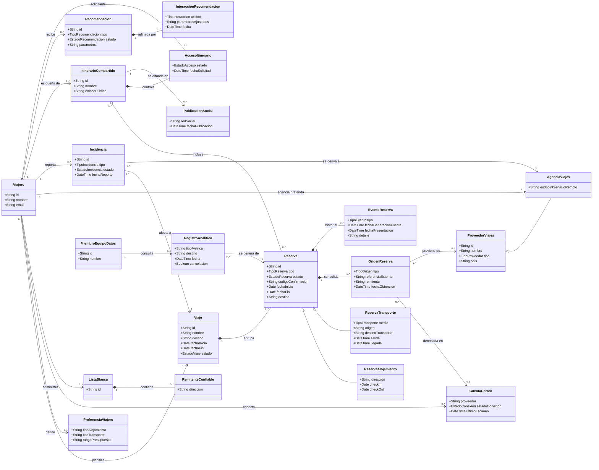

### 1.- Introduction

<!-- Create a description of the document -->

### 2.- Context diagram

<!-- Include the context diagram from the ArchitecturalDrivers.md document, if available. Include a paragraph at the beginning that describes what this diagram shows. -->

### 3.- Architectural drivers

<!-- Include a summary of the drivers described in ArchitecturalDrivers.md, including their priorities. You should separate user stories, quality attribute scenarios, concerns and constraints in separate tables. -->

### 4.- Domain model

El modelo de dominio se deriva de las historias de usuario US01 a US08 y captura los conceptos de negocio de Trotamundos con un nivel de granularidad medio: se modelan las entidades principales, sus relaciones y las pocas especializaciones que tienen impacto arquitectónico. Las variantes finas (cada medio de transporte, cada red social, cada proveedor de correo) se representan como atributos de tipo en lugar de subclases, y los detalles de implementación (credenciales, auditoría, identificadores técnicos) quedan fuera.

#### 4.1.- Diagrama de clases

#### 4.2.- Descripción de los elementos

| Elemento                     | Tipo                    | Descripción                                                                                                                                                                                                                                                                                           | Historias de usuario    |
| ---------------------------- | ----------------------- | ----------------------------------------------------------------------------------------------------------------------------------------------------------------------------------------------------------------------------------------------------------------------------------------------------- | ----------------------- |
| **Viajero**                  | Entidad / actor         | Usuario final del sistema. Es el dueño de sus viajes, cuentas de correo, whitelist, itinerarios compartidos e incidencias. El volumen objetivo es de 15 millones de cuentas (QA05).                                                                                                                   | US01 a US05, US07, US08 |
| **PreferenciaViajero**       | Entidad                 | Preferencias explícitas del viajero (alojamiento, transporte, presupuesto) que, junto con su historial, alimentan el sistema de recomendación.                                                                                                                                                        | US08                    |
| **Viaje**                    | Entidad (agregado raíz) | Agrupa las reservas de un mismo desplazamiento. Es el eje de organización del Dashboard. Cuando finaliza, sus reservas dejan de mostrarse en la vista.                                                                                                                                                | US01, US03              |
| **Reserva**                  | Entidad                 | Arreglo de viaje individual (hotel, auto, vuelo, tren, bus). Es la unidad de verdad del Dashboard. Se puede crear manualmente, detectar desde correo o sincronizar desde un tercero.                                                                                                                  | US01 a US04, US07       |
| **ReservaAlojamiento**       | Especialización         | Reserva de hospedaje, con datos específicos de dirección y check-in/check-out.                                                                                                                                                                                                                        | US01                    |
| **ReservaTransporte**        | Especialización         | Reserva de transporte (vuelo, tren, bus, auto). El medio se modela como atributo `medio` para poder incorporar nuevos medios sin crear nuevas clases (QA10).                                                                                                                                          | US01, US04              |
| **OrigenReserva**            | Entidad                 | Registra cada fuente de la que proviene la información de una reserva: manual, correo o proveedor externo. Permite que una misma reserva tenga varias fuentes, para identificar duplicados y consolidarlos sin repetir. Para fuentes de correo guarda el remitente, que habilita filtros y whitelist. | US01, US02, US03, US04  |
| **EventoReserva**            | Entidad                 | Historial de cambios de una reserva (creación, actualización, cancelación) recibidos de las fuentes. Guarda la fecha de generación en la fuente y de presentación en el dashboard, necesarias para medir QA01. Es también insumo de la analítica de cancelaciones.                                    | US04, US06              |
| **CuentaCorreo**             | Entidad                 | Cuenta de correo conectada por el viajero a través de la API del proveedor. Guarda el estado de la conexión y la fecha del último escaneo. El proveedor es un atributo para mantener neutralidad tecnológica (QA15).                                                                                  | US02                    |
| **ListaBlanca**              | Entidad                 | Conjunto de remitentes de correo confiables definido por el viajero.                                                                                                                                                                                                                                  | US03                    |
| **RemitenteConfiable**       | Entidad                 | Dirección o dominio de correo incluido en la whitelist. Se usa para decidir qué correos se procesan.                                                                                                                                                                                                  | US03                    |
| **ProveedorViajes**          | Entidad                 | Sistema externo del que se obtiene información de reservas: aerolínea, hotel, rentadora o sistema de viajes, accesible vía API estándar. El país permite configurar proveedores locales (QA13).                                                                                                       | US04                    |
| **AgenciaViajes**            | Especialización         | Proveedor que además ofrece un servicio remoto de resolución de problemas. El viajero elige su agencia preferida.                                                                                                                                                                                     | US05                    |
| **Incidencia**               | Entidad                 | Problema común reportado por el viajero durante un viaje (atención médica, equipaje perdido, vuelo retrasado). Se deriva al servicio remoto de la agencia elegida.                                                                                                                                    | US05                    |
| **ItinerarioCompartido**     | Entidad                 | Grupo de reservas que el viajero decide compartir. Tiene un enlace público por defecto, pero el acceso real está controlado por autorización (QA09).                                                                                                                                                  | US07                    |
| **AccesoItinerario**         | Entidad                 | Relación entre un viajero y un itinerario ajeno. Su estado es Pendiente, Autorizado o Denegado. El dueño puede autorizar o desautorizar en cualquier momento.                                                                                                                                         | US07                    |
| **PublicacionSocial**        | Entidad                 | Registro de la difusión de un itinerario en una red social externa. La red se modela como atributo para sumar redes sin cambiar el modelo (QA16).                                                                                                                                                     | US07                    |
| **Recomendacion**            | Entidad                 | Sugerencia proactiva de alojamiento, transporte o ruta generada a partir del historial y las preferencias del viajero.                                                                                                                                                                                | US08                    |
| **InteraccionRecomendacion** | Entidad                 | Acción del viajero sobre una recomendación (aceptar, rechazar, ajustar parámetros). Es la base del bucle human-in-the-loop que refina nuevas sugerencias.                                                                                                                                             | US08                    |
| **RegistroAnalitico**        | Entidad                 | Dato analítico derivado de las reservas (tendencias, destinos, cancelaciones) para calcular monetización. Se expone mediante una API de uso interno.                                                                                                                                                  | US06                    |
| **MiembroEquipoDatos**       | Entidad / actor         | Usuario interno que consulta los registros analíticos.                                                                                                                                                                                                                                                | US06                    |

#### 4.3.- Decisiones de modelado y supuestos

- **Reserva consolidada con múltiples orígenes.** El criterio de "no duplicar y agregar la información" de US01 se resuelve separando la reserva lógica (`Reserva`) de sus fuentes (`OrigenReserva`). Trade-off: agrega una entidad y una regla de correlación, pero evita perder información al fusionar duplicados.
- **Especializaciones mínimas.** Solo se especializa `Reserva` en alojamiento y transporte, porque sus datos difieren de forma significativa. El resto de variantes (medio de transporte, tipo de proveedor, red social, proveedor de correo) son atributos o enumeraciones, lo que favorece QA10, QA15 y QA16 y evita dependencias con servicios específicos.
- **Filtros como consultas, no entidades.** El filtrado por fecha, destino y remitente (US03) se resuelve sobre atributos de `Reserva` y `OrigenReserva`; no requiere clases propias.
- **Multirregión.** Se representa solo mediante el atributo `pais` de `ProveedorViajes`. El resto de la configuración regional se tratará como configuración y no como parte del dominio (QA13).
- **Hipótesis a confirmar:** (1) un viajero tiene una sola agencia preferida a la vez; (2) los registros analíticos se anonimizan o seudonimizan antes de llegar al equipo de datos; (3) el sistema de recomendación consume el historial de `Reserva` y `EventoReserva`, sin entidades adicionales en esta primera ronda.

### 5.- Diagrams

<!-- This section contains the proposed diagrams (module views, components and connectors, sequence, etc.); generate only those that are appropriate for the driver and explain why you chose that view or diagram. -->

### 6.- Interfaces

<!-- This section will include details about contracts- -->

### 7.- Design decisions

<!-- This section describes the relevant design decisions that resulted in this design. -->
